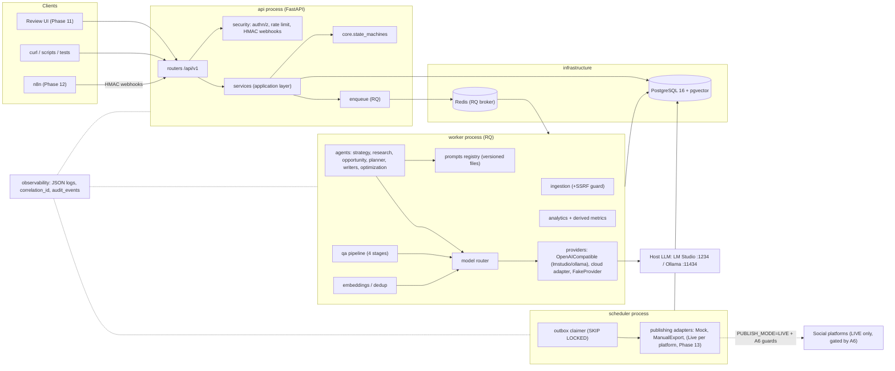
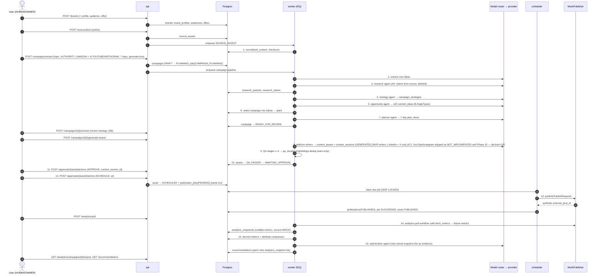

# ARCHITECTURE.md — OmniGrowth

Status: **Accepted at the Phase 1 gate (2026-09-23)**. ADR-0001…0008 are ACCEPTED.
Canonical names: [`docs/GLOSSARY.md`](docs/GLOSSARY.md). Data: [`docs/DATA_MODEL.md`](docs/DATA_MODEL.md). States: [`docs/STATE_MACHINES.md`](docs/STATE_MACHINES.md). API: [`docs/API_PLAN.md`](docs/API_PLAN.md). Platforms: [`docs/PLATFORM_CAPABILITIES.md`](docs/PLATFORM_CAPABILITIES.md).

---

## 1. Shape of the system

OmniGrowth is a **backend-first modular monolith**: one Python codebase (`omnigrowth/`) deployed as three processes that share one PostgreSQL database.

| Process | Role | Scales by |
|---|---|---|
| `api` | FastAPI app. Validates input, authenticates, applies state transitions, enqueues work. Never calls a platform inline, and calls an LLM inline only for the lightweight `/models/health` probe. | uvicorn workers |
| `worker` | RQ worker(s). Runs long jobs: ingestion, research, agent runs, generation, QA, embeddings, analytics pulls. | worker count; local-LLM concurrency capped at 1 (A2) |
| `scheduler` | Single async loop. Claims due `publication_jobs` from the Postgres outbox (`FOR UPDATE SKIP LOCKED`) **and dispatches them itself** (actor `SCHEDULER`; there is no separate publisher worker), and enqueues periodic analytics pulls. | 1 active instance is enough; >1 is safe (SKIP LOCKED) |

Infra: `postgres` (16 + pgvector), `redis` (RQ broker only; losing Redis never loses a publication, ADR-0003). LM Studio / Ollama run **on the host** and are reached at `host.docker.internal` from containers (A1). The frontend (A7, ADR-0007) and n8n (A7) come later and talk to the same `/api/v1`.

Why a monolith instead of microservices: one team, one database, strong transactional needs (state transitions + outbox + audit in one transaction). Module boundaries are enforced by package layout and import rules (§3), not by network hops.

## 2. Component diagram



## 3. Layers and dependency rules

```
api/  →  services/  →  (campaigns, content, research, ingestion, publishing, scheduling,
                        analytics, experiments, optimization, agents)  →  core/, schemas/, storage/, providers/
```

| Package (spec §4 + `core/`) | Owns | May import |
|---|---|---|
| `core/` | settings, `ErrorCode` + `OmniGrowthError`, JSON logging + correlation ids, secret masking, **state machines**, clock, ids | stdlib, pydantic |
| `schemas/` | Pydantic DTOs (API + agent I/O). `schemas/common.py` = `Page[T]`, `ErrorResponse`, enums | core |
| `models/` | SQLAlchemy ORM models (one module per domain) | core |
| `storage/` | engine/session factory, repositories, object storage for uploads | core, models |
| `providers/` | LLM provider interface + `OpenAICompatibleProvider`, cloud adapter, `FakeProvider` | core, schemas |
| `prompts/` | versioned prompt files `<domain>/<name>.v<N>.md` + loader | core |
| `agents/` | one module per agent: prompt ref + output schema + `run()` calling `generate_structured` | core, schemas, providers(router), prompts |
| `ingestion/`, `research/`, `content/`, `campaigns/`, `analytics/`, `experiments/`, `optimization/` | domain logic | core, schemas, storage, agents |
| `scheduling/` | outbox claimer + dispatcher (runs in the `scheduler` process) | core, schemas, storage, publishing (the `PlatformPublisher` interface and adapter registry only) |
| `publishing/` | `PlatformPublisher` interface + adapters. **No business logic.** | core, schemas |
| `security/` | authn/z, token hashing, HMAC verification, SSRF-safe HTTP client, credential encryption | core |
| `observability/` | log config, audit writer, metrics hooks | core, storage |
| `workflows/` | orchestration: chains agents for a campaign; RQ job entrypoints | everything below api |
| `services/` | application use-cases called by routers; transaction boundaries | everything below api |
| `api/` | routers, dependencies, exception handlers | services, schemas, security |

Rules (proposed: enforced from Phase 2 by an import-linter step added to `poe check` — this extends the canonical gate in AGENTS.md §4 and is part of ADR-0005, pending human approval):
1. `api` never imports `providers`, `publishing`, or `models` directly.
2. `publishing` adapters never import domain modules. Only `scheduling/` (dispatch) and `workflows/` may import `publishing/` — they receive a `PublishRequest` DTO and return a `PublishResult`. Only `workflows/` and the scheduler call publishers (including `fetch_metrics`); `analytics/` never imports `publishing/` — the analytics-pull workflow fetches metrics and hands DTOs to `analytics/`.
3. Nothing outside `core/state_machines` assigns `status` (AGENTS.md §4).
4. Only `providers/` performs LLM HTTP; only `publishing/` performs platform HTTP; only `security/http.py` (SSRF-safe client) fetches user-supplied URLs.

## 4. Model layer (ADR-0002)

- **One provider class** `OpenAICompatibleProvider(base_url, api_key?, capabilities)`; presets `lmstudio`, `ollama` in `config/models.yaml` (A1). Base URL: env `OMNIGROWTH_LOCAL_LLM_URL` > preset > error.
- **Roles → models** in config (`ModelRole` in GLOSSARY). No model name appears in Python.
- **Locality is per model, not per provider.** Each configured model declares `locality: LOCAL|REMOTE`; models whose names match `remote_patterns` (default `*-cloud`, `*:cloud`) are forced `REMOTE` even behind the `ollama` preset (PHASE0 R3).
- **Privacy routing** (§52): every task declares a `PrivacyClass`. `PRIVATE` → only `LOCAL` models; violation raises `PRIVACY_VIOLATION` (never silently downgrades to cloud).
- **Routing profiles** (§51): `LOCAL_ONLY` (default; tests use only this), `BALANCED`, `QUALITY_FIRST`. Fallback walks the role's ordered candidate list, filtered by profile + privacy + budget.
- **Structured generation** (§35): `generate_structured(schema, prompt_ref, inputs)` → capability-probed `response_format` (json_schema → json_object → prompt-only) → Pydantic validate → ≤2 repair attempts → `LLM_OUTPUT_INVALID` with raw payload persisted to `model_runs`.
- **Concurrency** (A2): per-provider semaphore, default 1; excess requests wait, don't fail.
- **Cloud adapter**: one adapter (config-selected), enabled only if `OMNIGROWTH_CLOUD_API_KEY` is set — never the generic `OPENAI_API_KEY` / `ANTHROPIC_BASE_URL` found in this machine's environment (PHASE0 R2, R5).
- **Cost** (§51): `model_runs` records tokens + estimated cost; per-campaign budget checked before each remote call (`BUDGET_EXCEEDED`).

## 5. Async work and scheduling (ADR-0003)

- RQ queues: `ingest`, `agents`, `generate`, `qa`, `embed`, `analytics`. Each job receives only IDs + correlation id; it reloads state from Postgres (jobs are idempotent and safe to re-run).
- Publication is **not** an RQ job. `publication_jobs` is a transactional outbox written in the same transaction that moves a ContentAsset to `SCHEDULED`. The scheduler claims rows with `SELECT … FOR UPDATE SKIP LOCKED`, leases them, and on unknown outcome marks `UNCERTAIN` (no auto-retry). Idempotency key = `sha256(lower(content_version_id) + ":" + lower(platform_account_id))` with a **partial** unique index (PROPOSED, pending human approval — ADR-0003).

## 6. §55 success-scenario data flow



In tests the LLM participant is `FakeProvider` (A8) and step 14 uses fixture analytics; the whole flow runs in one pytest. The exact API call sequence is API_PLAN §4. **Decision D1 (2026-09-23):** a minimal analytics + recommendations slice is built in Phase 7 so the MVP E2E covers all 16 steps.

## 7. Cross-cutting concerns

| Concern | Design | Spec |
|---|---|---|
| Errors | `OmniGrowthError(code: ErrorCode, message, details)`; API maps to `ErrorResponse`; no bare `except`. | §29 |
| Logging | JSON logs; contextvars carry `correlation_id`, `request_id`, `campaign_id`, `agent`, `model`; secret-masking filter on every handler. | §28 |
| Audit | Every state transition and every approval/publish writes `audit_events` in the same transaction. | §7 principle 7, §37 |
| Security | Bearer tokens (ADR-0006), role checks, per-token rate limits, upload limits + content sniffing, SSRF-safe fetcher (resolve → validate IP → connect to pinned IP → re-check each redirect), HMAC webhooks, credentials encrypted at rest. | §25, §26 |
| Publishing safety | `PUBLISH_MODE` default `MOCK`; LIVE requires A6's four conditions; `ENV=test` makes LIVE impossible (tested). | A6, §34 |
| Config | pydantic-settings from env + `config/*.yaml`; `.env.example` lists every variable; no secrets in YAML. | §25 |
| Prompts | `omnigrowth/prompts/<domain>/<name>.v<N>.md` with front-matter (id, version, role, privacy_class, output_schema). Version recorded on every `model_runs` row and content version. | §22 |
| Memory (§21) | Six memory types are **query surfaces over existing tables** (brand_profiles; content_versions+publications; analytics_snapshots; campaigns+campaign_strategies; audience signals; experiments), each with its own retrieval function — not separate stores. | §21, §24 |

## 8. Deployment topology (ADR-0008)

Docker Compose project name **`omnigrowth`** (other stacks are running on this Docker engine — PHASE0 R7). Host ports avoid the ones already taken (R1):

| Service | Container port | Host port |
|---|---|---|
| api | 8000 | 8000 |
| postgres | 5432 | **55432** |
| redis | 6379 | **56379** |
| worker, scheduler | — | — |

## 9. Repository structure (target, created in Phase 2)

```
omnigrowth/                 # python package (spec §4 + core/)
  core/ api/ services/ workflows/ agents/ campaigns/ content/ research/ ingestion/
  publishing/ scheduling/ analytics/ experiments/ optimization/ models/ providers/
  security/ storage/ prompts/ schemas/ observability/
tests/                      # unit/ integration/ workflow/ failure/ e2e/ + fixtures/llm/
alembic/                    # migrations (primary agent only)
config/                     # models.yaml, routing.yaml, metrics.yaml
scripts/                    # *.ps1 + *.sh pairs (A10)
docs/                       # spec, amendments, phases, ADRs, design docs, audit
frontend/                   # Phase 11: Vite + React + TS SPA (frontend/README.md)
n8n/                        # Phase 12
pyproject.toml  uv.lock  docker-compose.yml  .env.example
README.md SECURITY.md DEPLOYMENT.md DEVELOPMENT.md TESTING.md API.md PROMPTS.md CHANGELOG.md
```

## 10. Explicitly deferred
n8n (Phase 12), live platform connectors (Phase 13), web research provider (A5), audio/video transcription and OCR (§27 — `SourceType` accepted, processing raises `NotImplemented` with a tracking note).
