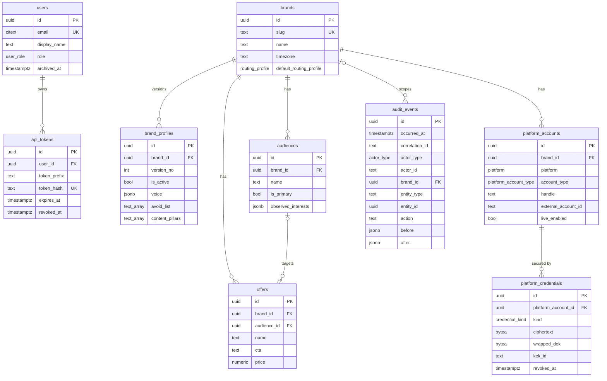
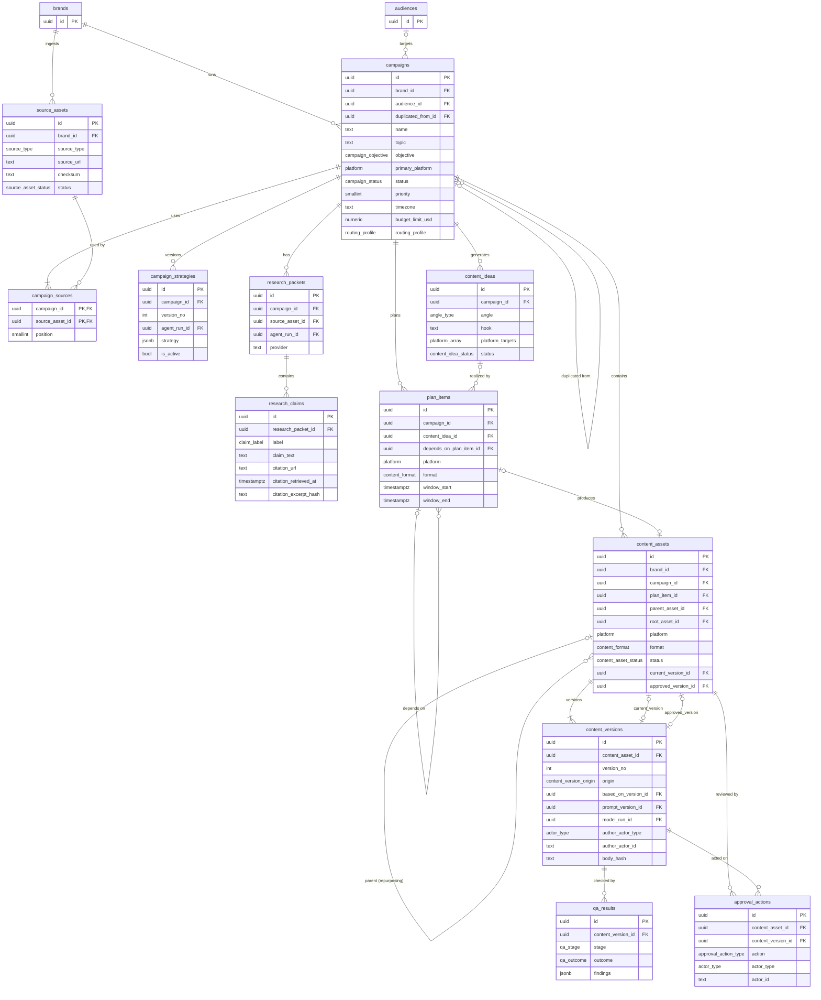
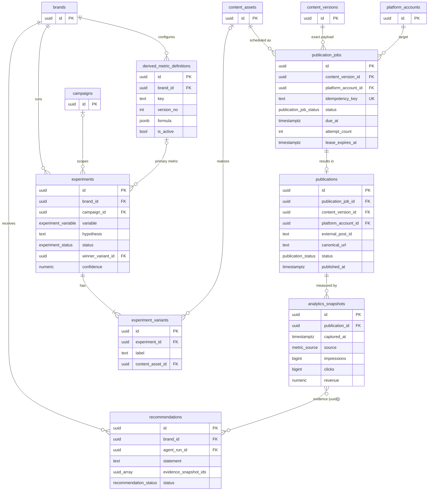
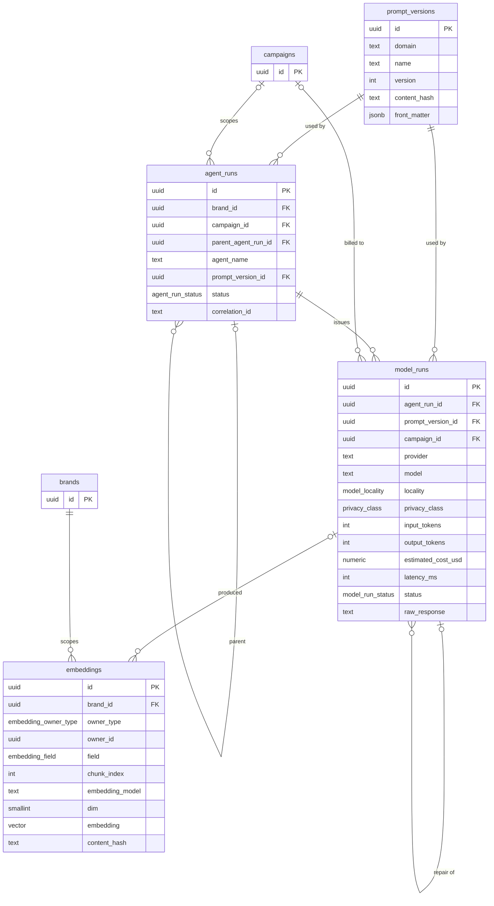

# DATA_MODEL.md — OmniGrowth (PostgreSQL 16 + pgvector)

Status: Phase 1 draft (PROPOSED). Precedence: AGENTS.md > SPEC_AMENDMENTS.md > PHASES.md > ADRs > spec.
Covers spec §5, §6, §9, §10, §14, §16, §17, §18, §21, §24, §31, §36, §37, §51 and amendments A3, A4, A5, A6.
Names follow `docs/GLOSSARY.md` (incl. §4a reconciliation additions). Any name still not in the glossary is listed in §9.1.

---

## 1. Conventions

| Rule | Detail |
|---|---|
| PK | `id uuid` on every table, UUIDv7 generated app-side (time-ordered → B-tree append locality). No DB default. |
| Timestamps | `timestamptz`, UTC. `created_at NOT NULL DEFAULT now()`; `updated_at NOT NULL DEFAULT now()` maintained by the ORM on mutable tables only. Immutable tables (`content_versions`, `audit_events`, `approval_actions`, `analytics_snapshots`, `model_runs`, `research_claims`, `qa_results`) have no `updated_at`. |
| Tenancy | Single-tenant, multi-brand. Every domain row carries `brand_id uuid NOT NULL REFERENCES brands(id)` unless noted. |
| Enum types | Postgres enum types. Glossary §4 state enums use the given names (`campaign_status`, …). Glossary §3 enums map PascalCase → snake_case type name: `Platform`→`platform`, `ContentFormat`→`content_format`, `SourceType`→`source_type`, `CampaignObjective`→`campaign_objective`, `FunnelStage`→`funnel_stage`, `AngleType`→`angle_type`, `ClaimLabel`→`claim_label`, `QaStage`→`qa_stage`, `QaOutcome`→`qa_outcome`, `ApprovalActionType`→`approval_action_type`, `ActorType`→`actor_type`, `UserRole`→`user_role`, `RoutingProfile`→`routing_profile`, `ModelRole`→`model_role`, `PrivacyClass`→`privacy_class`, `ModelLocality`→`model_locality`, `PublishMode`→`publish_mode`, `ErrorCode`→`error_code`. |
| Status writes | `status` columns written only by the state-machine module (AGENTS.md §4). DB does not encode transitions; see STATE_MACHINES.md. |
| Actor | Every write that a human or agent originates records `actor_type actor_type NOT NULL` + `actor_id text NOT NULL` (user UUID as text, or agent/service name e.g. `scheduler`, `strategy_agent`). `text` because agents are not rows. |
| Soft delete | `archived_at timestamptz NULL` on recoverable entities. Partial indexes add `WHERE archived_at IS NULL` where the hot query excludes archived rows. |
| FK actions | Default `ON DELETE RESTRICT` everywhere (hard deletes of domain rows are not performed; see §7). Only derived data (`embeddings`) is hard-deletable. |
| Money | `numeric(14,6)` for model cost (USD), `numeric(14,2)` + `char(3)` ISO currency for revenue/prices. Never `float`. |
| Hashes | `sha256` hex stored as `text` with `CHECK (x ~ '^[0-9a-f]{64}$')` unless noted. |
| Migrations | Alembic only; only the primary agent creates revisions (AGENTS.md §4). Extensions: `vector` (pgvector ≥ 0.7 for `halfvec`), `citext`. |

Abbreviations in column tables: **N** = nullable (`Y`/`N`), **Def** = default.

---

## 2. ER diagrams

Split by domain. Entities from another domain appear as stubs (PK only). Every glossary §2 table appears as a full entity in exactly one diagram.

### 2.1 Identity, brand & ops



### 2.2 Campaign, research & content



### 2.3 Publishing, analytics & experiments



### 2.4 AI runs, prompts & vectors



---

## 3. Tables — identity, brand & ops

### 3.1 `users`
| Column | Type | N | Def | Notes |
|---|---|---|---|---|
| id | uuid | N | — | PK |
| email | citext | N | — | Case-insensitive login identity |
| display_name | text | N | — | |
| role | user_role | N | `'VIEWER'` | Global role (single-tenant) |
| password_hash | text | N | — | argon2id encoded hash (ADR-0006 login); never returned by API or logged |
| is_active | boolean | N | `true` | Disabled users' tokens rejected |
| created_at / updated_at | timestamptz | N | now() | |
| archived_at | timestamptz | Y | — | |

Constraints: `UNIQUE (email)`.
Indexes: `users_email_key` (from UNIQUE) — serves login/token-owner lookup `WHERE email = $1`.
Note: `POST /auth/login` verifies `password_hash` and mints an `api_tokens` row (ADR-0006). OQ-1 resolved.

### 3.2 `api_tokens`
| Column | Type | N | Def | Notes |
|---|---|---|---|---|
| id | uuid | N | — | PK |
| user_id | uuid | N | — | FK `users.id` |
| name | text | N | — | Human label |
| token_prefix | text | N | — | First 8 chars of the token, for display/identification only |
| token_hash | text | N | — | sha256 hex of the full token. Plaintext token shown once at creation, never stored |
| scopes | text[] | N | `'{}'` | Reserved; role on `users` is authoritative in MVP |
| expires_at | timestamptz | Y | — | NULL = no expiry |
| last_used_at | timestamptz | Y | — | Updated at most once/minute per token (write amplification) |
| revoked_at | timestamptz | Y | — | Revocation is a soft flag; row kept for audit |
| created_at | timestamptz | N | now() | |

Constraints: `UNIQUE (token_hash)`; `CHECK (token_hash ~ '^[0-9a-f]{64}$')`.
Rationale: tokens are ≥256-bit random, so a fast unsalted sha256 is sufficient (no brute-force surface); constant-time compare is on the hash lookup path.
Indexes:
- `api_tokens_token_hash_key` (UNIQUE) — every authenticated request: `WHERE token_hash = $1 AND revoked_at IS NULL`.
- `api_tokens_user_id_idx (user_id)` — "list my tokens" and revoke-all-for-user.

### 3.3 `brands`
| Column | Type | N | Def | Notes |
|---|---|---|---|---|
| id | uuid | N | — | PK |
| slug | text | N | — | URL-safe identifier |
| name | text | N | — | §5 brand name |
| display_name | text | N | — | |
| timezone | text | N | `'UTC'` | IANA name; default for campaign calendars (§14). Validated app-side against zoneinfo |
| default_routing_profile | routing_profile | N | `'LOCAL_ONLY'` | A2 |
| auto_approve_enabled | boolean | N | `false` | §11 opt-in; OWNER only. Never sufficient for LIVE: live guard 3 requires a HUMAN approval (STATE_MACHINES Q6, decided 2026-09-23) |
| created_at / updated_at | timestamptz | N | now() | |
| archived_at | timestamptz | Y | — | |

Constraints: `UNIQUE (slug)`. Indexes: from UNIQUE — serves `GET /api/v1/brands/{slug}`.

### 3.4 `brand_profiles`
Append-only versions of the §5 Brand Profile (so every generation can cite the exact profile used, and §20 "do not auto-rewrite" is enforceable: changes are new versions with an actor).

| Column | Type | N | Def | Notes |
|---|---|---|---|---|
| id | uuid | N | — | PK |
| brand_id | uuid | N | — | FK |
| version_no | integer | N | — | 1..n per brand |
| is_active | boolean | N | `false` | Exactly one active per brand |
| company_description | text | Y | — | |
| niche | text | Y | — | |
| mission | text | Y | — | |
| products | jsonb | N | `'[]'` | |
| services | jsonb | N | `'[]'` | |
| differentiators | jsonb | N | `'[]'` | |
| voice | jsonb | N | `'{}'` | Attribute → score/category, e.g. `{"analytical":0.8}` (schema-validated) |
| avoid_list | text[] | N | `'{}'` | §5 Avoid List categories/patterns (e.g. "excessive emojis", "clickbait") — guidance for writers and Brand QA |
| banned_phrases | text[] | N | `'{}'` | Exact phrases the brand dislikes; Brand QA (§11) hard-fails on match |
| vocabulary | text[] | N | `'{}'` | Preferred brand vocabulary (§11 Brand QA "vocabulary") |
| content_pillars | text[] | N | `'{}'` | |
| actor_type / actor_id | actor_type / text | N | — | Who created this version |
| created_at | timestamptz | N | now() | |

Constraints: `UNIQUE (brand_id, version_no)`; `CHECK (version_no > 0)`.
Indexes:
- `brand_profiles_brand_version_key` (UNIQUE) — history listing `WHERE brand_id=$1 ORDER BY version_no DESC`.
- `brand_profiles_one_active_uq UNIQUE (brand_id) WHERE is_active` — enforces one active profile and serves Brand Memory "current profile" lookup used by every generation call.

### 3.5 `audiences`
| Column | Type | N | Def | Notes |
|---|---|---|---|---|
| id | uuid | N | — | PK |
| brand_id | uuid | N | — | FK |
| name | text | N | — | |
| is_primary | boolean | N | `false` | Primary vs secondary ICP (§5) |
| description | text | Y | — | ICP description |
| pains / goals / objections / common_questions / vocabulary | text[] | N | `'{}'` | §5 |
| sophistication_level | smallint | Y | — | `CHECK (BETWEEN 1 AND 5)` |
| observed_interests | jsonb | N | `'{}'` | Audience Memory (§21). Written only by accepting a `recommendations` row (evidence-backed), never directly by an agent (§20) |
| created_at / updated_at | timestamptz | N | now() | |
| archived_at | timestamptz | Y | — | |

Constraints: `UNIQUE (brand_id, name)`.
Indexes: `audiences_brand_name_key` — brand audience list and name lookup; `audiences_one_primary_uq UNIQUE (brand_id) WHERE is_primary AND archived_at IS NULL` — enforce single primary ICP; serves "primary ICP" fetch in Strategy Agent context.

### 3.6 `offers`
| Column | Type | N | Def | Notes |
|---|---|---|---|---|
| id | uuid | N | — | PK |
| brand_id | uuid | N | — | FK |
| audience_id | uuid | Y | — | FK `audiences.id` |
| name | text | N | — | §5 offer |
| price | numeric(14,2) | Y | — | |
| currency | char(3) | Y | — | Required iff price set: `CHECK ((price IS NULL) = (currency IS NULL))` |
| cta | text | Y | — | |
| funnel_destination_url | text | Y | — | Validated URL |
| proof | jsonb | N | `'[]'` | |
| objections | text[] | N | `'{}'` | |
| created_at / updated_at | timestamptz | N | now() | |
| archived_at | timestamptz | Y | — | |

Indexes: `offers_brand_active_idx (brand_id) WHERE archived_at IS NULL` — offer picker and RAG "offer details" (§24) per brand.

### 3.7 `platform_accounts`
| Column | Type | N | Def | Notes |
|---|---|---|---|---|
| id | uuid | N | — | PK |
| brand_id | uuid | N | — | FK |
| platform | platform | N | — | |
| account_type | platform_account_type | N | — | `PlatformAccountType` (GLOSSARY §4a) |
| handle | text | N | — | |
| display_name | text | Y | — | |
| external_account_id | text | Y | — | Platform-side ID once verified |
| timezone | text | Y | — | IANA; audience-local posting time hint. NULL = brand/campaign timezone |
| live_enabled | boolean | N | `false` | A6 gate #2. Changing it is audited |
| settings | jsonb | N | `'{}'` | Validated per-platform config (e.g. Reddit per-subreddit rules, Mastodon per-instance limits); schema-checked app-side per `platform` (PLATFORM_CAPABILITIES §4). Never holds secrets (those go in `platform_credentials`) |
| created_at / updated_at | timestamptz | N | now() | |
| archived_at | timestamptz | Y | — | |

Constraints: `UNIQUE (brand_id, platform, handle)`; `UNIQUE (platform, external_account_id)` (NULLs distinct → multiple unverified allowed).
Indexes: the two UNIQUEs — account lookup by handle in the UI; dedupe when an OAuth callback returns an external ID already linked.

### 3.8 `platform_credentials`
Encrypted at rest with **envelope encryption**; never returned by any API (no `Read` schema exists; ORM model excluded from serialization; `before`/`after` in `audit_events` store only `{id, kind, kek_id, expires_at}`).

| Column | Type | N | Def | Notes |
|---|---|---|---|---|
| id | uuid | N | — | PK |
| platform_account_id | uuid | N | — | FK |
| kind | credential_kind | N | — | `OAUTH2, API_KEY, APP_PASSWORD` |
| enc_alg | text | N | `'AES-256-GCM'` | |
| ciphertext | bytea | N | — | Secret JSON payload encrypted with a per-row DEK |
| nonce | bytea | N | — | 96-bit GCM nonce, unique per encryption |
| wrapped_dek | bytea | N | — | DEK encrypted by the KEK |
| kek_id | text | N | — | Identifies the KEK version used; enables rotation (re-wrap DEKs without touching ciphertext) |
| scopes | text[] | N | `'{}'` | Non-secret metadata |
| expires_at | timestamptz | Y | — | Token expiry for refresh scheduling |
| revoked_at | timestamptz | Y | — | |
| created_at / updated_at | timestamptz | N | now() | |

Envelope: KEK is never in the DB; it is loaded through the secret abstraction (§25) from env/secret provider via setting `OMNIGROWTH_CREDENTIAL_KEK` (OQ-6 resolved); the row's `kek_id` names the KEK version. AAD for GCM = `id || platform_account_id || kind`, so a ciphertext cannot be swapped onto another row. Decrypt only inside the publisher adapter process; plaintext never logged (masking filter, Phase 2).
Constraints: `CHECK (octet_length(nonce) = 12)`.
Indexes: `platform_credentials_active_uq UNIQUE (platform_account_id, kind) WHERE revoked_at IS NULL` — one live credential per kind; serves publisher fetch `WHERE platform_account_id=$1 AND kind=$2 AND revoked_at IS NULL`. `platform_credentials_expiry_idx (expires_at) WHERE revoked_at IS NULL` — refresh sweeper "tokens expiring within N minutes".

### 3.9 `audit_events`
Append-only. Enforced by (a) app DB role granted `INSERT, SELECT` only, and (b) `BEFORE UPDATE OR DELETE` trigger raising an exception (defense-in-depth for superuser/migration mistakes).

| Column | Type | N | Def | Notes |
|---|---|---|---|---|
| id | uuid | N | — | PK (UUIDv7) |
| occurred_at | timestamptz | N | now() | |
| correlation_id | text | N | — | From request/job context (§28) |
| actor_type | actor_type | N | — | |
| actor_id | text | N | — | |
| brand_id | uuid | Y | — | FK; NULL for global events (user/token admin) |
| entity_type | text | N | — | Table name, e.g. `content_assets` |
| entity_id | uuid | N | — | No FK (polymorphic) |
| action | text | N | — | Dotted verb, e.g. `status.transition`, `credential.rotate`, `platform_account.live_enabled.set` |
| before | jsonb | Y | — | Masked snapshot of changed fields; NULL on create |
| after | jsonb | Y | — | Masked snapshot; NULL on archive-only events |
| metadata | jsonb | N | `'{}'` | e.g. `{"from":"APPROVED","to":"SCHEDULED"}`, request IP |

Indexes:
- `audit_events_entity_timeline_idx (entity_type, entity_id, occurred_at)` — per-entity history `WHERE entity_type=$1 AND entity_id=$2 ORDER BY occurred_at`.
- `audit_events_correlation_idx (correlation_id)` — reconstruct everything one request/job did (debugging, §28).
- `audit_events_brand_time_idx (brand_id, occurred_at DESC)` — brand activity feed.
- `audit_events_actor_time_idx (actor_type, actor_id, occurred_at DESC)` — "what did user X / agent Y do" review.

API mapping: `AuditEventRead` exposes `occurred_at`, `action`, `before`, `after`, `metadata` (plus ids/actor/correlation) unchanged; `entity_type` values are table names (e.g. `content_assets`, `publication_jobs`), not schema names.
Growth: if volume warrants, range-partition by `occurred_at` monthly (PK becomes `(id, occurred_at)`); not needed for MVP.

---

## 4. Tables — campaign, research & content

### 4.1 `source_assets`
| Column | Type | N | Def | Notes |
|---|---|---|---|---|
| id | uuid | N | — | PK |
| brand_id | uuid | N | — | FK |
| source_type | source_type | N | — | |
| source_url | text | Y | — | Post-SSRF-validation URL (§26); required for `URL`, `YOUTUBE_URL` |
| title | text | Y | — | |
| mime_type | text | Y | — | Validated content type (§25) |
| byte_size | bigint | Y | — | |
| storage_uri | text | Y | — | Location of original bytes for binary uploads (OQ-7) |
| raw_content | text | Y | — | Extracted text before normalization |
| normalized_content | text | Y | — | `NormalizedDocument` text |
| transcript | text | Y | — | TRANSCRIPT/SUBTITLE/(later) AUDIO/VIDEO |
| metadata | jsonb | N | `'{}'` | Parser metadata, final redirect chain, etc. |
| checksum | text | N | — | sha256 of original bytes |
| status | source_asset_status | N | `'PENDING'` | `PENDING, NORMALIZED, FAILED, UNSUPPORTED` (AUDIO/VIDEO → `UNSUPPORTED` until implemented) |
| error_code | error_code | Y | — | Set when `FAILED` (e.g. `SSRF_BLOCKED`, `INGESTION_FAILURE`) |
| actor_type / actor_id | actor_type / text | N | — | Uploader |
| created_at / updated_at | timestamptz | N | now() | |
| archived_at | timestamptz | Y | — | |

Constraints: `UNIQUE (brand_id, checksum)` — re-uploading identical bytes returns the existing asset. `CHECK (source_type NOT IN ('URL','YOUTUBE_URL') OR source_url IS NOT NULL)`.
Indexes: `source_assets_brand_checksum_key` — dedupe on ingest; `source_assets_brand_created_idx (brand_id, created_at DESC) WHERE archived_at IS NULL` — `/api/v1/sources` list.

### 4.2 `campaigns`
| Column | Type | N | Def | Notes |
|---|---|---|---|---|
| id | uuid | N | — | PK |
| brand_id | uuid | N | — | FK |
| name | text | N | — | |
| objective | campaign_objective | N | — | |
| topic | text | N | — | User input (§39 wizard) |
| primary_platform | platform | N | — | User input; the Strategy Agent's *chosen* platforms live in `campaign_strategies` |
| secondary_platforms | platform[] | N | `'{}'` | User input |
| audience_id | uuid | Y | — | FK |
| offer_id | uuid | Y | — | FK — primary offer/CTA target |
| content_pillar | text | Y | — | Must be in active brand profile's pillars (app check) |
| status | campaign_status | N | `'DRAFT'` | |
| priority | smallint | N | `3` | `CHECK (priority BETWEEN 1 AND 5)`; 1 = highest (matches API) |
| start_date / end_date | date | Y | — | In campaign timezone; `CHECK (end_date >= start_date)` |
| timezone | text | Y | — | IANA; NULL = use `brands.timezone` (OQ-13 resolved) |
| routing_profile | routing_profile | N | — | Copied from brand default at creation; user-overridable (§23, §51) |
| currency | char(3) | N | `'USD'` | Display/reporting currency for the campaign |
| budget_limit_usd | numeric(14,6) | Y | — | §51; NULL = unlimited. Enforced pre-call by summing `model_runs.estimated_cost_usd` → `BUDGET_EXCEEDED`. (API field name may differ; API_PLAN maps it) |
| duplicated_from_id | uuid | Y | — | FK self — §12 "duplicate campaign" provenance; `CHECK (duplicated_from_id <> id)` |
| actor_type / actor_id | actor_type / text | N | — | Creator |
| created_at / updated_at | timestamptz | N | now() | |
| archived_at | timestamptz | Y | — | |

Sources are linked through `campaign_sources` (§4.2a); there is no `source_asset_id` column (§6 `source_id` = the `position = 0` source).
Indexes: `campaigns_brand_status_idx (brand_id, status) WHERE archived_at IS NULL` — campaign list filtered by status and "active campaigns" context for Opportunity Agent; `campaigns_brand_created_idx (brand_id, created_at DESC)` — Campaign Memory "prior campaigns" chronological retrieval; `campaigns_duplicated_from_idx (duplicated_from_id) WHERE duplicated_from_id IS NOT NULL` — "campaigns cloned from X".

### 4.2a `campaign_sources`
Join table: a campaign may draw on several source assets (OQ-8 resolved). Rows are added/removed while the campaign is `DRAFT`/`PLANNING`; changes are audited.

| Column | Type | N | Def | Notes |
|---|---|---|---|---|
| campaign_id | uuid | N | — | FK `campaigns.id`; PK part |
| source_asset_id | uuid | N | — | FK `source_assets.id`; PK part. Must be same brand (app check) |
| position | smallint | N | `0` | Order; `0` = primary source. `CHECK (position >= 0)` |
| created_at | timestamptz | N | now() | |

Constraints: `PRIMARY KEY (campaign_id, source_asset_id)`; `UNIQUE (campaign_id, position)` — deterministic ordering, one primary.
Indexes:
- PK — list a campaign's sources (`WHERE campaign_id=$1 ORDER BY position` via the UNIQUE).
- `campaign_sources_campaign_position_key` (UNIQUE) — ordered source list / primary-source lookup `position = 0`.
- `campaign_sources_source_idx (source_asset_id)` — "which campaigns used this source" (source detail page; blocks archiving a source in use).

### 4.3 `campaign_strategies`
| Column | Type | N | Def | Notes |
|---|---|---|---|---|
| id | uuid | N | — | PK |
| brand_id | uuid | N | — | FK |
| campaign_id | uuid | N | — | FK |
| version_no | integer | N | — | |
| is_active | boolean | N | `false` | |
| agent_run_id | uuid | Y | — | FK; NULL if human-authored |
| strategy | jsonb | N | — | Full validated Strategy Agent output (§7A) |
| positioning | text | N | — | Extracted for query/display |
| funnel_stage | funnel_stage | N | — | |
| primary_cta | text | Y | — | |
| primary_platform | platform | N | — | |
| secondary_platforms | platform[] | N | `'{}'` | |
| actor_type / actor_id | actor_type / text | N | — | |
| created_at | timestamptz | N | now() | Immutable row |

Platform fields here are the platforms the **Strategy Agent chose** (agent output). `campaigns.primary_platform` / `secondary_platforms` are the **user's input** to the wizard (§39); the two may differ and both are kept.
Constraints: `UNIQUE (campaign_id, version_no)`.
Indexes: the UNIQUE — version history; `campaign_strategies_active_uq UNIQUE (campaign_id) WHERE is_active` — one active strategy; serves Planner/Writer context fetch.

### 4.4 `research_packets`
| Column | Type | N | Def | Notes |
|---|---|---|---|---|
| id | uuid | N | — | PK |
| brand_id | uuid | N | — | FK |
| campaign_id | uuid | N | — | FK |
| source_asset_id | uuid | Y | — | FK; source the claims were extracted from |
| agent_run_id | uuid | Y | — | FK |
| provider | text | N | `'null'` | `ResearchProvider` id (A5: `NullResearchProvider` default) |
| summary | text | Y | — | |
| created_at | timestamptz | N | now() | |
| archived_at | timestamptz | Y | — | Superseded packets are archived, not deleted |

Indexes: `research_packets_campaign_current_uq UNIQUE (campaign_id) WHERE archived_at IS NULL` — "one packet per campaign" (glossary); serves Accuracy QA packet lookup.

### 4.5 `research_claims`
Immutable.

| Column | Type | N | Def | Notes |
|---|---|---|---|---|
| id | uuid | N | — | PK |
| research_packet_id | uuid | N | — | FK |
| ordinal | integer | N | — | Order within packet |
| claim_text | text | N | — | |
| label | claim_label | N | — | A5 |
| source_excerpt | text | Y | — | Verbatim span from source asset |
| citation_url | text | Y | — | |
| citation_retrieved_at | timestamptz | Y | — | |
| citation_excerpt_hash | text | Y | — | sha256 of cited excerpt |
| created_at | timestamptz | N | now() | |

Constraints: `UNIQUE (research_packet_id, ordinal)`; citation all-or-none: `CHECK ((citation_url IS NULL) = (citation_retrieved_at IS NULL) AND (citation_url IS NULL) = (citation_excerpt_hash IS NULL))` (A5 — a citation without provenance cannot be stored).
Indexes: UNIQUE — list claims of a packet in order; `research_claims_packet_url_idx (research_packet_id, citation_url) WHERE citation_url IS NOT NULL` — Accuracy QA "is this cited URL in the packet?" check (A5 rejection rule).

### 4.6 `content_ideas`
| Column | Type | N | Def | Notes |
|---|---|---|---|---|
| id | uuid | N | — | PK |
| brand_id / campaign_id | uuid | N | — | FKs |
| agent_run_id | uuid | Y | — | FK |
| angle | angle_type | N | — | |
| hook | text | N | — | |
| audience_id | uuid | Y | — | FK |
| platform_targets | platform[] | N | `'{}'` | |
| estimated_value | numeric(6,3) | Y | — | Agent's relative score; not a prediction |
| evidence | jsonb | N | `'[]'` | Refs to `research_claims.id` / source spans |
| status | content_idea_status | N | `'PROPOSED'` | `PROPOSED, SELECTED, DISCARDED` |
| created_at / updated_at | timestamptz | N | now() | |

Indexes: `content_ideas_campaign_angle_idx (campaign_id, angle)` — Phase 5 gate query "≥20 ideas across 8 angle types" and idea browser grouped by angle.

### 4.7 `plan_items`
| Column | Type | N | Def | Notes |
|---|---|---|---|---|
| id | uuid | N | — | PK |
| brand_id / campaign_id | uuid | N | — | FKs |
| agent_run_id | uuid | Y | — | FK |
| horizon_days | smallint | N | — | `CHECK (horizon_days IN (7,14,30))` |
| ordinal | integer | N | — | |
| platform | platform | N | — | |
| format | content_format | N | — | |
| angle | angle_type | N | — | |
| objective | campaign_objective | N | — | |
| funnel_stage | funnel_stage | N | — | |
| cta | text | Y | — | |
| source_asset_id | uuid | Y | — | FK |
| content_idea_id | uuid | Y | — | FK |
| stale | boolean | N | `false` | Set when strategy/research is regenerated after planning; stale items are not auto-generated (API_PLAN) |
| depends_on_plan_item_id | uuid | Y | — | FK self; same campaign (app check); `CHECK (depends_on_plan_item_id <> id)` |
| window_start / window_end | timestamptz | N | — | Publication window; `CHECK (window_end > window_start)` |
| created_at / updated_at | timestamptz | N | now() | |
| archived_at | timestamptz | Y | — | |

Constraints: `UNIQUE (campaign_id, horizon_days, ordinal)`.
Indexes: `plan_items_campaign_window_idx (campaign_id, window_start)` — calendar view `/api/v1/calendar` for a campaign; `plan_items_brand_window_idx (brand_id, window_start) WHERE archived_at IS NULL` — cross-campaign calendar for a brand.

### 4.8 `content_assets`
Mutable header of a piece of content; all text lives in `content_versions`.

| Column | Type | N | Def | Notes |
|---|---|---|---|---|
| id | uuid | N | — | PK |
| brand_id | uuid | N | — | FK |
| campaign_id | uuid | N | — | FK |
| plan_item_id | uuid | Y | — | FK; NULL for repurposed children not in the plan |
| content_idea_id | uuid | Y | — | FK |
| parent_asset_id | uuid | Y | — | FK self — repurposing source (§9) |
| root_asset_id | uuid | N | — | FK self — lineage root (= `id` for roots). Set at insert from parent |
| lineage_depth | smallint | N | `0` | parent.depth + 1; `CHECK (lineage_depth BETWEEN 0 AND 5)` |
| platform | platform | N | — | |
| format | content_format | N | — | |
| status | content_asset_status | N | `'DRAFT'` | |
| current_version_id | uuid | Y | — | Latest version (NULL only before first version insert) |
| generation_request_id | uuid | Y | — | Id of the generation job currently expected to write the next version; stale results are discarded (STATE_MACHINES A2/A18) |
| auto_regeneration_count | smallint | N | `0` | SYSTEM-initiated regenerations after QA_FAILED; capped by config (STATE_MACHINES A18) |
| approved_version_id | uuid | Y | — | Version approved for publication (A6 gate #3) |
| quality_score | numeric(5,2) | Y | — | Aggregate from `qa_results`; NULL until QA |
| audience_id / offer_id | uuid | Y | — | FKs — §16 attributes |
| pillar | text | Y | — | §16 |
| topic | text | Y | — | §16 |
| angle | angle_type | Y | — | §16 hook/angle attribute |
| funnel_stage | funnel_stage | Y | — | |
| created_at / updated_at | timestamptz | N | now() | |
| archived_at | timestamptz | Y | — | |

Constraints:
- `UNIQUE (brand_id, id)` (target for same-brand composite FK) and `FOREIGN KEY (brand_id, parent_asset_id) REFERENCES content_assets (brand_id, id)` — parent must be in the same brand.
- `CHECK (parent_asset_id IS NULL OR parent_asset_id <> id)`; `CHECK ((parent_asset_id IS NULL) = (root_asset_id = id))`.
- `FOREIGN KEY (id, current_version_id) REFERENCES content_versions (content_asset_id, id)` and same for `approved_version_id` — the pointed-to version must belong to this asset (MATCH SIMPLE: skipped while NULL).
- `UNIQUE (plan_item_id)` — one asset per plan item (NULLs distinct).

**Cycle prevention (§9, Phase 10 gate).** Three layers:
1. *Structural*: `parent_asset_id` is set only at INSERT and must reference an already-existing row. A new row cannot be an ancestor of an existing row, so inserts alone can only build a forest. Cycles become possible only via UPDATE of `parent_asset_id`.
2. *App-level*: the repurposing service forbids re-parenting; any API that would change lineage runs a recursive-CTE ancestor walk from the proposed parent (`WITH RECURSIVE anc AS (...) SELECT 1 FROM anc WHERE id = $self`) inside the same transaction with `SELECT … FOR UPDATE` on both rows, raising `VALIDATION_FAILURE` on hit, and enforces `lineage_depth` ≤ configured max. Also warns (not blocks, §10) when a child has the same `(platform, format)` as an ancestor — the "recursive duplicate" pattern.
3. *DB (recommended, primary-agent decision)*: `BEFORE UPDATE OF parent_asset_id, root_asset_id` trigger raising an exception unconditionally → lineage immutable at DB level; with (1) this makes cycles impossible without needing a recursive check in the trigger.

Indexes:
- `content_assets_campaign_status_idx (campaign_id, status) WHERE archived_at IS NULL` — content queue per campaign.
- `content_assets_brand_status_idx (brand_id, status, updated_at DESC) WHERE archived_at IS NULL` — approvals inbox `status='AWAITING_APPROVAL'` across campaigns (§12).
- `content_assets_parent_idx (parent_asset_id) WHERE parent_asset_id IS NOT NULL` — children of an asset (repurposing tree expand, recursive CTE step).
- `content_assets_root_idx (root_asset_id)` — whole lineage fetch in one scan.
- `content_assets_attr_idx (brand_id, platform, format)` — §16 attribute-to-outcome grouping joins.

### 4.9 `content_versions`
**Immutable**: app role has `INSERT, SELECT` only; `BEFORE UPDATE OR DELETE` trigger raises. Every edit or regeneration inserts a new row (§36). Diffs are computed on read between any two versions (no stored diffs).

| Column | Type | N | Def | Notes |
|---|---|---|---|---|
| id | uuid | N | — | PK |
| content_asset_id | uuid | N | — | FK |
| version_no | integer | N | — | 1..n per asset, assigned under `SELECT … FOR UPDATE` on the asset row |
| origin | content_version_origin | N | — | `GENERATED, HUMAN_EDIT, REGENERATION` — preserves original generation vs human edits (§36) |
| based_on_version_id | uuid | Y | — | FK self; the version this was edited/regenerated from (diff base) |
| title | text | Y | — | |
| hook | text | Y | — | |
| body | text | N | — | |
| cta | text | Y | — | |
| media_requirements | jsonb | N | `'[]'` | |
| platform_payload | jsonb | N | `'{}'` | Format-specific structure (thread parts, carousel slides, video outline) |
| body_hash | text | N | — | sha256 of canonical rendered content; detects no-op edits |
| word_count / char_count | integer | N | — | §16 attributes; computed at insert |
| hook_type / cta_type / media_type | text | Y | — | §16 attributes (OQ-9 re enums) |
| prompt_version_id | uuid | Y | — | FK; NULL for `HUMAN_EDIT` |
| model_run_id | uuid | Y | — | FK; the successful model call; NULL for `HUMAN_EDIT` |
| agent_run_id | uuid | Y | — | FK |
| brand_profile_id | uuid | Y | — | FK — profile version used for generation |
| author_actor_type | actor_type | N | — | |
| author_actor_id | text | N | — | |
| created_at | timestamptz | N | now() | |

Constraints: `UNIQUE (content_asset_id, version_no)`; `UNIQUE (content_asset_id, id)` (composite-FK target for asset pointers); `CHECK (origin = 'HUMAN_EDIT' OR (prompt_version_id IS NOT NULL AND model_run_id IS NOT NULL))`; `CHECK (origin <> 'GENERATED' OR based_on_version_id IS NULL)`.
"Final publication version" (§36) = `publications.content_version_id`; no separate flag needed.
Indexes:
- `content_versions_asset_version_key` (UNIQUE) — version history / diff picker `ORDER BY version_no`.
- `content_versions_prompt_idx (prompt_version_id)` — §16 "generation prompt version vs outcome" and "which assets used prompt vN" (prompt regression review).
- `content_versions_model_run_idx (model_run_id)` — model-used attribution join.

### 4.10 `qa_results`
| Column | Type | N | Def | Notes |
|---|---|---|---|---|
| id | uuid | N | — | PK |
| content_version_id | uuid | N | — | FK |
| stage | qa_stage | N | — | |
| outcome | qa_outcome | N | — | |
| score | numeric(5,2) | Y | — | |
| findings | jsonb | N | `'[]'` | `[{rule, severity, message, span}]` |
| checker | text | N | — | Rule-set id or agent name |
| model_run_id | uuid | Y | — | FK when LLM-assisted |
| prompt_version_id | uuid | Y | — | FK |
| created_at | timestamptz | N | now() | |

Constraints: `UNIQUE (content_version_id, stage)` (glossary: one row per version × stage; versions are immutable so QA is run once per version — see OQ-10).
Indexes: UNIQUE — QA panel for a version; `qa_results_stage_outcome_idx (stage, outcome, created_at DESC)` — QA failure-rate dashboards by stage.

### 4.11 `approval_actions`
Append-only (same enforcement as `audit_events`). Records every §37 action and actor.

| Column | Type | N | Def | Notes |
|---|---|---|---|---|
| id | uuid | N | — | PK |
| brand_id | uuid | N | — | FK |
| content_asset_id | uuid | N | — | FK |
| content_version_id | uuid | N | — | FK — version the action applied to |
| resulting_version_id | uuid | Y | — | FK — new version for `EDIT` / `REGENERATE` |
| action | approval_action_type | N | — | |
| from_status / to_status | content_asset_status | N | — | Transition performed |
| scheduled_for | timestamptz | Y | — | Required for `SCHEDULE`: `CHECK (action <> 'SCHEDULE' OR scheduled_for IS NOT NULL)` |
| platform_account_id | uuid | Y | — | FK — target for `SCHEDULE` / `PUBLISH_NOW` |
| comment | text | Y | — | Required for `REJECT` / `REQUEST_REVISION` (app check) |
| actor_type / actor_id | actor_type / text | N | — | |
| correlation_id | text | N | — | |
| created_at | timestamptz | N | now() | |

Indexes: `approval_actions_asset_time_idx (content_asset_id, created_at)` — approval history on the asset detail page; `approval_actions_actor_time_idx (actor_id, created_at DESC)` — reviewer activity.

---

## 5. Tables — publishing, analytics & experiments

### 5.1 `publication_jobs` (transactional outbox, A3)
| Column | Type | N | Def | Notes |
|---|---|---|---|---|
| id | uuid | N | — | PK |
| brand_id | uuid | N | — | FK |
| content_asset_id | uuid | N | — | FK |
| content_version_id | uuid | N | — | FK — exact immutable payload to publish |
| platform_account_id | uuid | N | — | FK |
| idempotency_key | text | N | — | `sha256(content_version_id ‖ platform_account_id)` hex, computed app-side (A3). Canonical input: lowercase hyphenated UUID text of each, joined by `':'` (OQ-3) |
| status | publication_job_status | N | `'PENDING'` | |
| due_at | timestamptz | N | — | UTC instant to attempt; for `RETRY_WAIT` = next backoff time |
| schedule_timezone | text | N | — | IANA zone the user scheduled in (display/audit only) |
| publish_mode | publish_mode | Y | — | Mode actually used, stamped at dispatch start (STATE_MACHINES §3.4 step 2) |
| attempt_count | integer | N | `0` | Incremented at dispatch start (not at claim), so a claim that never dispatches does not consume an attempt |
| correlation_id | text | N | — | §28; propagated to the publication row, audit events and logs of every attempt |
| max_attempts | integer | N | `5` | From config at enqueue |
| claimed_by | text | Y | — | Scheduler instance id |
| claimed_at | timestamptz | Y | — | |
| claim_token | uuid | Y | — | Set at claim; every outcome write is fenced by `AND claim_token = :t` |
| lease_expires_at | timestamptz | Y | — | Crash detection. Expired `CLAIMED` lease: if `dispatch_started_at IS NULL` → back to `PENDING` (no call was made); else → `UNCERTAIN` (the call may have happened), never auto-retried |
| dispatch_started_at | timestamptz | Y | — | Committed *before* any network I/O (STATE_MACHINES §3.4 step 2) |
| last_error_code | error_code | Y | — | |
| last_error | jsonb | Y | — | Masked detail |
| completed_at | timestamptz | Y | — | Terminal-state time |
| actor_type / actor_id | actor_type / text | N | — | Who scheduled (from approval action) |
| created_at / updated_at | timestamptz | N | now() | |

Constraints:
- Partial unique index `publication_jobs_idempotency_live_uq UNIQUE (idempotency_key) WHERE status IN ('PENDING','CLAIMED','RETRY_WAIT','SUCCEEDED','UNCERTAIN')`; `CHECK (idempotency_key ~ '^[0-9a-f]{64}$')`. At most one non-terminal-or-succeeded job per (version, account). `FAILED`/`CANCELLED` rows are proven-not-published and stay as history; a manual retry inserts a new row. **Status: PROPOSED** — this partial form narrows A3's "unique index" and is pending human approval at the Phase 1 gate (ADR-0003; STATE_MACHINES Q1). If rejected, fall back to a full `UNIQUE (idempotency_key)` with retry = transition of the existing row.
- `CHECK (attempt_count <= max_attempts)`; `CHECK (status <> 'CLAIMED' OR (claimed_at IS NOT NULL AND lease_expires_at IS NOT NULL AND claim_token IS NOT NULL))`.
- A6 guards 1–3 are pre-checked at SCHEDULE request and re-checked authoritatively at dispatch start (STATE_MACHINES §3.3).

Indexes:
- `publication_jobs_idempotency_live_uq` (partial UNIQUE, above) — duplicate-post prevention; the two-schedulers race test (Phase 7) relies on it for enqueue and on SKIP LOCKED for execution.
- `publication_jobs_claim_idx (due_at) WHERE status IN ('PENDING','RETRY_WAIT')` — the scheduler claim query (STATE_MACHINES §3.4 step 1); tiny index (only live rows), overdue rows naturally included (missed-job recovery):
  ```sql
  UPDATE publication_jobs j
     SET status = 'CLAIMED', claim_token = :uuid, claimed_by = :scheduler_id,
         claimed_at = now(), lease_expires_at = now() + :lease
   WHERE j.id IN (
     SELECT pj.id FROM publication_jobs pj
       JOIN content_assets a ON a.id = pj.content_asset_id
       JOIN campaigns c      ON c.id = a.campaign_id
      WHERE pj.status IN ('PENDING','RETRY_WAIT') AND pj.due_at <= now()
        AND a.status = 'SCHEDULED' AND c.status = 'ACTIVE'
      ORDER BY pj.due_at
      LIMIT :batch
      FOR UPDATE OF pj SKIP LOCKED)
  RETURNING j.*;
  ```
  The `pj.status IN ('PENDING','RETRY_WAIT')` predicate must be written exactly as in the index so the planner matches the partial index; the joins probe `content_assets`/`campaigns` by PK for the few due rows.
- `publication_jobs_lease_idx (lease_expires_at) WHERE status = 'CLAIMED'` — reaper `WHERE status='CLAIMED' AND lease_expires_at < now()`.
- `publication_jobs_account_uncertain_idx (platform_account_id) WHERE status = 'UNCERTAIN'` — A6 gate #4 "no open uncertain for this account" (job side) and reconciliation queue.
- `publication_jobs_asset_idx (content_asset_id)` — job history on asset page; cancel-all-jobs on asset archive.

### 5.2 `publications`
The external post. Created at dispatch start (status `PUBLISHING`, in the same transaction that sets `publication_jobs.dispatch_started_at`, before any network I/O — STATE_MACHINES §3.4 step 2 / P1) so an outcome is always recorded, including unknown ones. A claim that never dispatches creates no publication.

| Column | Type | N | Def | Notes |
|---|---|---|---|---|
| id | uuid | N | — | PK |
| brand_id | uuid | N | — | FK |
| publication_job_id | uuid | N | — | FK |
| content_asset_id | uuid | N | — | FK |
| content_version_id | uuid | N | — | FK — the §36 "final publication version" |
| platform_account_id | uuid | N | — | FK |
| platform | platform | N | — | Denormalized for analytics grouping |
| publish_mode | publish_mode | N | — | `MOCK`/`MANUAL`/`LIVE` — lets reports exclude mock data |
| external_post_id | text | Y | — | Platform ID; key for reconciliation (§14) |
| canonical_url | text | Y | — | |
| status | publication_status | N | `'PUBLISHING'` | |
| scheduled_at | timestamptz | N | — | Copy of job `due_at` at dispatch start |
| published_at | timestamptz | Y | — | Platform-reported or manual-confirmed time; §16 posting time |
| error | jsonb | Y | — | Masked |
| reconciled_at | timestamptz | Y | — | When an `PUBLICATION_UNCERTAIN` was resolved |
| reconciled_by_actor_type / reconciled_by_actor_id | actor_type / text | Y | — | |
| created_at / updated_at | timestamptz | N | now() | |

Constraints: `UNIQUE (publication_job_id)` (one publication per job); `UNIQUE (platform_account_id, external_post_id)` (NULLs distinct) — the same external post cannot be recorded twice (reconciliation safety); `CHECK (status <> 'PUBLISHED' OR published_at IS NOT NULL)`.
No hard delete; `DELETED` status records a post removed on the platform.
Indexes:
- `publications_account_uncertain_idx (platform_account_id) WHERE status = 'PUBLICATION_UNCERTAIN'` — A6 live-publish guard (hot path before every live publish).
- `publications_brand_published_idx (brand_id, published_at DESC) WHERE status = 'PUBLISHED'` — Content Memory "what has been published", recent-post fatigue window (§10).
- `publications_asset_idx (content_asset_id)` — asset → publications.
- `publications_manual_pending_idx (brand_id) WHERE status = 'MANUAL_PENDING'` — manual-export to-do list (A6 `ManualExportPublisher`).

### 5.3 `analytics_snapshots`
Immutable time series. **All metrics NULLABLE, no defaults** — NULL = "platform does not expose / not captured", never 0 (§6, Phase 8 gate).

| Column | Type | N | Def | Notes |
|---|---|---|---|---|
| id | uuid | N | — | PK |
| brand_id | uuid | N | — | FK (denormalized for brand-wide reports) |
| publication_id | uuid | N | — | FK |
| captured_at | timestamptz | N | — | §6 `timestamp`; the as-of time of the metrics |
| source | metric_source | N | — | `MOCK, FIXTURE, API, MANUAL` |
| impressions / views / reach | bigint | Y | — | |
| likes / comments / shares / saves / clicks / profile_visits | bigint | Y | — | |
| followers_gained | integer | Y | — | May be negative (net). The API schema must allow negative values for this field only |
| watch_time_seconds | numeric(16,3) | Y | — | |
| average_view_duration_seconds | numeric(12,3) | Y | — | |
| ctr | numeric(9,6) | Y | — | Platform-reported only; our own click rate is derived (§17) |
| conversion_count | bigint | Y | — | |
| revenue | numeric(14,2) | Y | — | |
| revenue_currency | char(3) | Y | — | `CHECK ((revenue IS NULL) = (revenue_currency IS NULL))` |
| platform_metrics | jsonb | N | `'{}'` | Platform-specific metrics with no column (e.g. dwell proxies, open rate, upvote ratio). Keys absent = not captured; never filled with 0 |
| raw_payload | jsonb | Y | — | Original API/fixture payload for audit |
| created_at | timestamptz | N | now() | Ingestion time |

Constraints: `UNIQUE (publication_id, captured_at)` — idempotent re-ingest; `CHECK (x IS NULL OR x >= 0)` for every count except `followers_gained`; `CHECK (ctr IS NULL OR ctr BETWEEN 0 AND 1)`.
Derived metrics (§17) are computed at query time with `NULLIF(denominator,0)`; any NULL input → NULL output. No derived value is stored.
Indexes:
- `analytics_snapshots_publication_captured_key` (UNIQUE) — latest snapshot per publication via `DISTINCT ON (publication_id) … ORDER BY publication_id, captured_at DESC` (backward scan) and per-post time series.
- `analytics_snapshots_brand_captured_idx (brand_id, captured_at DESC)` — Performance Memory windows ("last 30 days", §19) and campaign reports.

### 5.4 `derived_metric_definitions`
| Column | Type | N | Def | Notes |
|---|---|---|---|---|
| id | uuid | N | — | PK |
| brand_id | uuid | Y | — | FK; NULL = system default available to all brands |
| key | text | N | — | e.g. `engagement_rate`, `content_efficiency` |
| version_no | integer | N | — | |
| name | text | N | — | |
| description | text | Y | — | Must state that weights are subjective (§17) |
| formula | jsonb | N | — | Restricted AST: `{op: ratio|weighted_sum, numerator: [...], denominator: [...], terms: [{metric, weight}]}` over whitelisted metric names. Never evaluated as code (AGENTS.md §3) |
| is_active | boolean | N | `false` | |
| actor_type / actor_id | actor_type / text | N | — | |
| created_at | timestamptz | N | now() | Immutable row; edit = new version |

Constraints: `UNIQUE NULLS NOT DISTINCT (brand_id, key, version_no)` (PG15+ syntax).
Indexes: the UNIQUE — history; `derived_metric_definitions_active_uq UNIQUE NULLS NOT DISTINCT (brand_id, key) WHERE is_active` — resolve the active formula for a key (brand override, else system default).

### 5.5 `experiments`
| Column | Type | N | Def | Notes |
|---|---|---|---|---|
| id | uuid | N | — | PK |
| brand_id | uuid | N | — | FK |
| campaign_id | uuid | Y | — | FK |
| name | text | N | — | |
| hypothesis | text | N | — | |
| variable | experiment_variable | N | — | `HOOK, TITLE, IMAGE, CTA, POST_LENGTH, POSTING_TIME, CAROUSEL_LENGTH, VIDEO_OPENING, THUMBNAIL, TOPIC` (§18) |
| metric_definition_id | uuid | Y | — | FK `derived_metric_definitions.id` (pinned version) |
| raw_metric | text | Y | — | Alternative: a raw snapshot column name. `CHECK ((metric_definition_id IS NULL) <> (raw_metric IS NULL))` |
| min_sample_size | integer | N | — | Guard (§18, Phase 9 gate) |
| confidence_threshold | numeric(4,3) | N | `0.950` | |
| status | experiment_status | N | `'DRAFT'` | |
| start_at / end_at | timestamptz | Y | — | |
| result | jsonb | Y | — | Stats output incl. per-variant n, estimate, interval, method |
| confidence | numeric(4,3) | Y | — | |
| winner_variant_id | uuid | Y | — | FK `(id, winner_variant_id) → experiment_variants(experiment_id, id)`; `CHECK (winner_variant_id IS NULL OR status = 'CONCLUDED')` |
| concluded_at | timestamptz | Y | — | |
| created_at / updated_at | timestamptz | N | now() | |
| archived_at | timestamptz | Y | — | |

Indexes: `experiments_brand_status_idx (brand_id, status)` — running-experiment monitor and Experiment Memory (`status IN ('CONCLUDED','INCONCLUSIVE')`).

### 5.6 `experiment_variants`
| Column | Type | N | Def | Notes |
|---|---|---|---|---|
| id | uuid | N | — | PK |
| experiment_id | uuid | N | — | FK |
| label | text | N | — | `A`, `B`, … |
| description | text | N | — | What differs |
| content_asset_id | uuid | Y | — | FK — the asset realizing the variant |
| sample_size | bigint | Y | — | Observed n; NULL until measured |
| observed_value | numeric | Y | — | NULL until measured |
| created_at / updated_at | timestamptz | N | now() | |

Constraints: `UNIQUE (experiment_id, label)`; `UNIQUE (experiment_id, id)` (winner FK target).
Indexes: UNIQUE — variants of an experiment; `experiment_variants_asset_idx (content_asset_id)` — "is this asset part of an experiment" (scheduler must not reschedule variants independently).

### 5.7 `recommendations`
| Column | Type | N | Def | Notes |
|---|---|---|---|---|
| id | uuid | N | — | PK |
| brand_id | uuid | N | — | FK |
| campaign_id | uuid | Y | — | FK |
| agent_run_id | uuid | N | — | FK — Optimization Agent run |
| statement | text | N | — | e.g. "Technical posts produced 2.1× saves…" |
| rationale | text | Y | — | |
| evidence_snapshot_ids | uuid[] | N | — | `CHECK (cardinality(evidence_snapshot_ids) >= 1)` (Phase 9 gate). App validates every id exists and belongs to `brand_id` before insert (arrays cannot carry FKs; OQ-11) |
| evidence_query | jsonb | N | — | Filters/aggregation that produced the figure, so it is reproducible |
| target | text | Y | — | What it would change, e.g. `audiences.observed_interests`, `campaign_strategies` |
| status | recommendation_status | N | `'PROPOSED'` | `PROPOSED, ACCEPTED, DISMISSED` |
| decided_by_actor_type / decided_by_actor_id | actor_type / text | Y | — | Human decision (§20: no automatic profile rewrite) |
| created_at / updated_at | timestamptz | N | now() | |

Indexes: `recommendations_brand_status_idx (brand_id, status, created_at DESC)` — pending-recommendation inbox; `recommendations_evidence_gin (evidence_snapshot_ids) USING gin` — "which recommendations cite snapshot X" (evidence traceability when a snapshot is disputed).

---

## 6. Tables — AI runs, prompts & vectors

### 6.1 `prompt_versions`
Registry of prompt files (`omnigrowth/prompts/<domain>/<name>.v<N>.md`). Rows are upserted by the loader at startup; immutable once written.

| Column | Type | N | Def | Notes |
|---|---|---|---|---|
| id | uuid | N | — | PK |
| domain | text | N | — | e.g. `strategy`, `linkedin`, `qa` |
| name | text | N | — | |
| version | integer | N | — | `N` from filename |
| content_hash | text | N | — | sha256 of file bytes |
| front_matter | jsonb | N | — | Parsed front-matter (output schema name, model_role, privacy_class, …) |
| body | text | N | — | Snapshot of prompt text for reproducibility |
| created_at | timestamptz | N | now() | |

Constraints: `UNIQUE (domain, name, version)`. Loader rule: if a row exists with a different `content_hash`, startup fails ("edited prompt without version bump").
Indexes: the UNIQUE — resolve `prompt_ref → id` at every generation call.

### 6.2 `agent_runs`
| Column | Type | N | Def | Notes |
|---|---|---|---|---|
| id | uuid | N | — | PK |
| brand_id | uuid | N | — | FK |
| campaign_id | uuid | Y | — | FK |
| parent_agent_run_id | uuid | Y | — | FK self — orchestration chain (§55 steps) |
| agent_name | text | N | — | e.g. `strategy_agent`, `linkedin_writer` |
| prompt_version_id | uuid | Y | — | FK |
| brand_profile_id | uuid | Y | — | FK — context used |
| status | agent_run_status | N | `'RUNNING'` | `RUNNING, SUCCEEDED, FAILED` |
| input_ref | jsonb | N | — | IDs of inputs (not the full text) |
| output | jsonb | Y | — | Validated structured output |
| error_code | error_code | Y | — | |
| correlation_id | text | N | — | |
| rq_job_id | text | Y | — | Queue job id (A3) |
| started_at | timestamptz | N | now() | |
| finished_at | timestamptz | Y | — | |

Indexes: `agent_runs_campaign_started_idx (campaign_id, started_at)` — campaign orchestration trace; `agent_runs_correlation_idx (correlation_id)` — debugging; `agent_runs_parent_idx (parent_agent_run_id) WHERE parent_agent_run_id IS NOT NULL` — expand run tree.

### 6.3 `model_runs`
One row per provider call (including each repair attempt). Immutable.

| Column | Type | N | Def | Notes |
|---|---|---|---|---|
| id | uuid | N | — | PK |
| brand_id | uuid | Y | — | FK; NULL for health checks |
| campaign_id | uuid | Y | — | FK — §51 cost attribution / budget |
| agent_run_id | uuid | Y | — | FK |
| repair_of_model_run_id | uuid | Y | — | FK self — previous attempt this one repairs |
| attempt_no | smallint | N | `0` | 0 = initial, 1–2 = repairs (AGENTS.md §4). `CHECK (attempt_no BETWEEN 0 AND 2)` |
| task | text | N | — | §51 task name (routing key) |
| model_role | model_role | N | — | |
| routing_profile | routing_profile | N | — | |
| provider | text | N | — | Provider preset/adapter id (config) |
| model | text | N | — | Model id as reported/configured |
| locality | model_locality | N | — | Classified per model (PHASE0 R3) |
| privacy_class | privacy_class | N | — | Of the task payload |
| structured_output_mode | text | Y | — | `json_schema` / `json_object` / `prompt_only` (A1) |
| prompt_version_id | uuid | Y | — | FK |
| input_hash | text | N | — | sha256 of rendered input; FakeProvider fixture key (A8) |
| input_tokens / output_tokens | integer | Y | — | NULL if provider does not report |
| estimated_cost_usd | numeric(14,6) | Y | — | NULL = unknown; `0` only when known-free (LOCAL) |
| latency_ms | integer | Y | — | |
| status | model_run_status | N | — | `SUCCEEDED, FAILED` |
| error_code | error_code | Y | — | e.g. `LLM_OUTPUT_INVALID`, `MODEL_TIMEOUT`; `CHECK ((status = 'FAILED') = (error_code IS NOT NULL))` |
| raw_response | text | Y | — | **Required when `error_code = 'LLM_OUTPUT_INVALID'`** (AGENTS.md §4): `CHECK (error_code IS DISTINCT FROM 'LLM_OUTPUT_INVALID' OR raw_response IS NOT NULL)`. Stored on success only if config enables it. Secret-masked before insert |
| correlation_id | text | N | — | |
| created_at | timestamptz | N | now() | |

Constraints: `CHECK (NOT (privacy_class = 'PRIVATE' AND locality = 'REMOTE'))` — DB backstop for §52 (a violating call is refused by the router before it happens; this guarantees it can never be recorded as having happened silently).
Indexes:
- `model_runs_campaign_cost_idx (campaign_id, created_at) INCLUDE (estimated_cost_usd)` — budget check `SUM(estimated_cost_usd) WHERE campaign_id=$1` (index-only scan) and campaign cost report.
- `model_runs_agent_run_idx (agent_run_id)` — calls within an agent run, repair chain.
- `model_runs_created_idx (created_at DESC)` — `/api/v1/models` usage dashboard by provider/model over time.
- `model_runs_failed_idx (error_code, created_at DESC) WHERE status = 'FAILED'` — failure triage.

### 6.4 `embeddings` (pgvector, A4)

**Fixed-dimension problem.** pgvector's HNSW/IVFFlat indexes require every indexed value to have one known dimension (typed `vector(N)`), and cap it (`vector` ≤ 2,000 dims; `halfvec` ≤ 4,000). A4 makes the embedding model a router role whose model — hence dimension — can change (Phase 0: `nomic-embed-text` family is 768-d; `qwen3-embedding` default is up to 4,096-d; exact dims UNKNOWN until Phase 3). A single `vector(768)` column would reject a different model; mixing dims in one index is impossible.

Options considered:
| Option | Verdict |
|---|---|
| A. One `vector(N)` column per supported dimension | Rejected: sparse nullable columns, a migration per new dimension anyway, two models with the same dim would share an index and silently mix incompatible spaces. |
| B. One table per embedding model | Rejected: dynamic DDL outside Alembic, polymorphic queries across tables, FK/ownership duplicated. |
| **C. One table, dimensionless `vector` column + one partial expression HNSW index per registered embedding model** | **Chosen.** |

Design C: column `embedding vector` (no typmod) + `dim` + `embedding_model`. For each embedding model enabled in config, the primary agent adds an Alembic revision:
```sql
CREATE INDEX CONCURRENTLY embeddings_hnsw_<model_slug>
  ON embeddings USING hnsw ((embedding::vector(768)) vector_cosine_ops)
  WHERE embedding_model = '<embedding_model id>';
```
(for 2,001–4,000 dims the expression is `embedding::halfvec(N)` with `halfvec_cosine_ops`; > 4,000 dims must be configured to a Matryoshka-truncated output dimension, or run unindexed.) Queries must repeat the same cast and predicate to use the index:
```sql
SELECT owner_type, owner_id, (embedding::vector(768)) <=> $1::vector(768) AS distance
FROM embeddings
WHERE embedding_model = $model AND brand_id = $brand AND owner_type = $type
ORDER BY (embedding::vector(768)) <=> $1::vector(768)
LIMIT $k;
```
Why: one table and one query shape; each model's vectors live in their own index (spaces never mix, keyed by model not just dim); old and new model rows coexist during re-embedding; a model without an index still works via exact scan (fine at MVP scale), so the index migration is a performance step, not a correctness one. Brand/owner filters are post-filters on HNSW; with pgvector ≥ 0.8 enable `hnsw.iterative_scan = relaxed_order` to avoid under-filled results (single-tenant → few brands, low selectivity loss).

**Changing model = re-embed job** (A4): set the new `embedding_model` as target in config → RQ job re-embeds every owner (skipping rows whose `content_hash` already has a new-model row) → config switches the read model → old-model rows hard-deleted (derived data, §7) and their index dropped in a later revision. Querying with a vector of the wrong dimension fails loudly on the cast; no silent mismatch.

| Column | Type | N | Def | Notes |
|---|---|---|---|---|
| id | uuid | N | — | PK |
| brand_id | uuid | N | — | FK |
| owner_type | embedding_owner_type | N | — | `CONTENT_VERSION, SOURCE_ASSET, RESEARCH_CLAIM, BRAND_PROFILE, AUDIENCE, OFFER, CAMPAIGN_STRATEGY, CONTENT_IDEA` |
| owner_id | uuid | N | — | Polymorphic, no FK; orphan check in a periodic integrity job |
| field | embedding_field | N | `'FULL'` | `FULL, HOOK, CTA, CHUNK` — separate hook/CTA vectors serve §10 repeated-hook / CTA-repetition checks |
| chunk_index | integer | N | `0` | For chunked long sources (RAG §24) |
| embedding_model | text | N | — | Config id, provider-qualified (e.g. `ollama:nomic-embed-text:latest`) |
| dim | smallint | N | — | `CHECK (vector_dims(embedding) = dim)` |
| embedding | vector | N | — | Dimensionless column; see above |
| content_hash | text | N | — | sha256 of the embedded text; skip re-embedding unchanged text |
| model_run_id | uuid | Y | — | FK — cost/latency of the embedding call |
| created_at | timestamptz | N | now() | |

Constraints: `UNIQUE (owner_type, owner_id, field, chunk_index, embedding_model)`.
Indexes:
- UNIQUE — upsert target for the embed job; "does owner X have a current-model vector".
- `embeddings_hnsw_<model_slug>` (partial expression HNSW, one per registered model) — §10 near-duplicate / fatigue search and §24 retrieval.
- `embeddings_model_idx (embedding_model)` — re-embed progress (`count(*) GROUP BY embedding_model`) and old-model cleanup.

Similarity threshold (§10) is config, not schema. Duplicate warnings are written as `qa_results.findings` (stage `PLATFORM` or `BRAND`; STATE_MACHINES/QA doc decides), never as deletions.

---

## 6a. Tables — platform plumbing (added at Phase 1 reconciliation, from API_PLAN §9)

### 6a.1 `jobs`
Durable record of every async (RQ) job so `GET /api/v1/jobs/{id}` survives Redis loss. RQ holds only the job id.

| Column | Type | N | Def | Notes |
|---|---|---|---|---|
| id | uuid | N | — | PK; also the RQ job id |
| brand_id | uuid | Y | — | FK |
| campaign_id | uuid | Y | — | FK |
| kind | job_kind | N | — | `JobKind` (GLOSSARY) |
| status | job_status | N | `'QUEUED'` | `QUEUED, RUNNING, SUCCEEDED, FAILED, CANCELLED`. Written only by the small jobs status helper in `omnigrowth/core/state_machines` — a simple linear machine: `QUEUED→RUNNING→SUCCEEDED|FAILED`, `QUEUED→CANCELLED` |
| subject_type / subject_id | text / uuid | Y | — | Entity the job acts on |
| requested_by_type / requested_by_id | actor_type / text | N | — | |
| correlation_id | text | N | — | §28 |
| attempt_count | smallint | N | `0` | |
| result | jsonb | Y | — | References (ids) only, never large payloads |
| error_code | error_code | Y | — | |
| error | jsonb | Y | — | Masked |
| queued_at / started_at / finished_at | timestamptz | — | — | |

Indexes: `jobs_subject_idx (subject_type, subject_id, queued_at DESC)` — "latest job for this campaign/source"; `jobs_active_idx (status, queued_at) WHERE status IN ('QUEUED','RUNNING')` — stuck-job sweeper.

### 6a.2 `idempotency_keys`
Request-level `Idempotency-Key` store (API_PLAN §1). Distinct from `publication_jobs.idempotency_key` (A3), which remains the DB-level duplicate-post guard.

| Column | Type | N | Def | Notes |
|---|---|---|---|---|
| id | uuid | N | — | PK |
| principal_type | text | N | — | `CHECK (principal_type IN ('USER','WEBHOOK_ENDPOINT'))` — keys are scoped per principal, not per token, so rotating a token does not break in-flight retries |
| principal_id | uuid | N | — | `users.id` or (Phase 12) `webhook_endpoints.id`; polymorphic, no FK |
| method | text | N | — | HTTP method |
| route | text | N | — | Route template (e.g. `/api/v1/campaigns/{campaign_id}/approve`), not the concrete path |
| key | text | N | — | Client-supplied; `CHECK (char_length(key) BETWEEN 8 AND 128)` |
| state | text | N | `'IN_PROGRESS'` | `CHECK (state IN ('IN_PROGRESS','COMPLETED'))`; a concurrent duplicate while `IN_PROGRESS` → 409 `CONFLICT` |
| request_hash | text | N | — | sha256 of canonical body; mismatch → 409 `CONFLICT` |
| response_status | smallint | Y | — | NULL while `IN_PROGRESS` |
| response_body | jsonb | Y | — | Replayed on retry once `COMPLETED` |
| created_at | timestamptz | N | now() | |
| expires_at | timestamptz | N | — | TTL 24 h |

Constraints: `UNIQUE (principal_type, principal_id, method, route, key)`; `CHECK (state <> 'COMPLETED' OR response_status IS NOT NULL)`.
Indexes: from UNIQUE — lookup/insert-on-conflict on every idempotent request; `idempotency_keys_expires_idx (expires_at)` — purge job (these rows are the one hard-deleted class besides superseded embeddings).

### 6a.3 `app_settings`
DB-backed tunables and §23 routing overrides. Key/value; ENV-sourced settings (PUBLISH_MODE, ENV, limits) are **never** stored here.

| Column | Type | N | Def | Notes |
|---|---|---|---|---|
| brand_id | uuid | Y | — | NULL = global |
| key | text | N | — | e.g. `routing.override.<task>`, `dedup.similarity_threshold` |
| value | jsonb | N | — | Validated against a Pydantic schema per key |
| updated_by | uuid | N | — | FK users |
| updated_at | timestamptz | N | now() | |

Constraints: `UNIQUE NULLS NOT DISTINCT (brand_id, key)`. Every change writes `audit_events`.

### 6a.4 Deferred to Phase 12
`webhook_endpoints` (inbound HMAC secrets, hashed + rotation grace) and `webhook_subscriptions` (outbound targets, allowlisted) are named here and designed in Phase 12.

---

## 7. Memory types (§21) → tables and queries

Each memory type is a separate repository module with its own queries; none requires loading another's data (§21 "queryable independently"). RAG (§24) filters `embeddings.owner_type` per memory type and injects top-k only.

| Memory | Backing tables | Canonical query (sketch) | Serving index |
|---|---|---|---|
| **Brand** (stable identity) | `brands`, `brand_profiles` (active), `audiences`, `offers`; embeddings `BRAND_PROFILE`/`OFFER`/`AUDIENCE` | `brand_profiles WHERE brand_id=$b AND is_active`; offers/audiences `WHERE archived_at IS NULL` | `brand_profiles_one_active_uq`, `offers_brand_active_idx` |
| **Content** (already published) | `publications` ⋈ `content_versions` ⋈ `content_assets`; embeddings `CONTENT_VERSION` (`FULL`/`HOOK`/`CTA`) | `publications WHERE brand_id=$b AND status='PUBLISHED' AND published_at > now()-$window` + vector kNN restricted to those version ids for §10 | `publications_brand_published_idx`, HNSW |
| **Performance** (historical results) | `analytics_snapshots` (latest per publication) ⋈ `publications` ⋈ `content_versions`/`content_assets` attributes; `derived_metric_definitions` | `DISTINCT ON (publication_id)` latest snapshot, derived metric via active formula, `GROUP BY` §16 attribute | `analytics_snapshots_publication_captured_key`, `…_brand_captured_idx`, `content_assets_attr_idx` |
| **Campaign** (prior objectives & strategies) | `campaigns`, `campaign_strategies` (active), `plan_items`, `research_packets`/`research_claims`; embeddings `CAMPAIGN_STRATEGY` | `campaigns WHERE brand_id=$b ORDER BY created_at DESC` ⋈ active strategy | `campaigns_brand_created_idx`, `campaign_strategies_active_uq` |
| **Audience** (observed interests) | `audiences.observed_interests` (accepted, evidence-backed) + performance aggregated by `content_assets.audience_id` and `pillar/topic` | `audiences WHERE brand_id=$b`; `… GROUP BY audience_id, pillar` over Performance query | `audiences_brand_name_key`, Performance indexes |
| **Experiment** (completed tests) | `experiments` (`CONCLUDED`,`INCONCLUSIVE`), `experiment_variants`, `recommendations` (`ACCEPTED`) | `experiments WHERE brand_id=$b AND status IN ('CONCLUDED','INCONCLUSIVE')` | `experiments_brand_status_idx` |

Mock data isolation: Performance/Content queries filter `publications.publish_mode` and `analytics_snapshots.source` so `MOCK`/`FIXTURE` data never feeds real recommendations unless explicitly requested (tests do request it).

---

## 8. Retention & deletion

| Class | Tables | Policy |
|---|---|---|
| Never hard-deleted | `content_assets`, `content_versions`, `publication_jobs`, `publications`, `analytics_snapshots`, `audit_events`, `approval_actions`, `qa_results`, `model_runs`, `agent_runs`, `research_claims`, `recommendations`, `experiments`, `experiment_variants`, `campaign_strategies`, `brand_profiles`, `prompt_versions`, `derived_metric_definitions` | Immutable or state-terminal. Removal from views = `archived_at` (where present) or terminal status (`CANCELLED`, `DELETED`, `ARCHIVED`). Enforced by app role lacking `DELETE` on these tables + triggers on immutable tables. |
| Soft-deleted (`archived_at`) | `users`, `brands`, `audiences`, `offers`, `platform_accounts`, `source_assets`, `campaigns`, `content_assets`, `plan_items`, `research_packets`, `experiments` | Archive sets `archived_at` + audit event; restore clears it. Archiving a brand does not cascade; children are filtered by brand. Archiving an asset cancels its non-terminal `publication_jobs` via the state machine. |
| Revoked, kept | `api_tokens`, `platform_credentials` | `revoked_at`. Credential ciphertext is retained on revoke (unreadable without the KEK) until a crypto-shred policy is decided (OQ-12). |
| Link rows | `campaign_sources` | May be deleted only while the campaign is `DRAFT`/`PLANNING` (before any generation used them); every add/remove writes `audit_events`. |
| Hard-deletable (derived) | `embeddings` | Regenerable from source rows; deleted on model cutover or when owner is archived (optional). |
| Raw payload trimming | `model_runs.raw_response`, `analytics_snapshots.raw_payload` | May be nulled after a configurable retention (default: keep) **except** `raw_response` on `LLM_OUTPUT_INVALID` rows, which the CHECK keeps. Trimming is an audited admin job. |

Personal data erasure requests (e.g. a user leaving) are handled by anonymizing `users.email/display_name`, not by deleting rows referenced as `actor_id`.

---

## 9. Open questions & name proposals

### 9.1 Names not in GLOSSARY.md
All enum/type names used here were adopted in GLOSSARY §4a (enum type-name rule, `MetricSource`, `ContentVersionOrigin`, `ContentIdeaStatus`, `SourceAssetStatus`, `AgentRunStatus`, `ModelRunStatus`, `RecommendationStatus`, `ExperimentVariable`, `CredentialKind`, `EmbeddingOwnerType`, `EmbeddingField`, `PlatformAccountType`, `JobStatus`, `JobKind`).

Tables beyond glossary §2 used here are all in GLOSSARY §4a: `campaign_sources`, `jobs`, `idempotency_keys`, `app_settings` (and Phase 12 `webhook_endpoints`, `webhook_subscriptions`, named only). Array columns are still used instead of join tables for `recommendations.evidence_snapshot_ids`, `platform_targets`, `secondary_platforms`.

Remaining unlisted identifiers (column-level check values, not enums): `idempotency_keys.principal_type` (`USER, WEBHOOK_ENDPOINT`) and `idempotency_keys.state` (`IN_PROGRESS, COMPLETED`) — text + CHECK; promote to glossary enums if the API exposes them.

### 9.2 Open questions
- **OQ-1 Human login.** RESOLVED (primary, reconciliation): ADR-0006 uses argon2id password login → `users.password_hash` added.
- **OQ-2 Glossary wording on `embeddings`.** RESOLVED: GLOSSARY §4a adopts one `vector` column + one partial HNSW index per model. Original text: Glossary says "fixed-dimension column per embedding model"; this doc realizes that as a fixed-dimension *expression index* per model over a dimensionless column (§6.4). Confirm or amend glossary text.
- **OQ-3 Idempotency-key canonical form.** RESOLVED: recorded in ADR-0003. Original text: A3 says `sha256(content_version_id + platform_account_id)`; this doc fixes the input as `lower(uuid_text) || ':' || lower(uuid_text)` hex-encoded. Needs to be in ADR-0003 so every writer agrees.
- **OQ-4 Re-publishing the same version.** PROPOSED (primary), pending human approval at the Phase 1 gate (ADR-0003): partial unique index, manual retry = new row; FAILED stays terminal. Original text: Full UNIQUE on `idempotency_key` means a `CANCELLED`/`FAILED` job for (version, account) blocks a new job row; reschedule must transition the existing row back to `PENDING`. Is that acceptable in STATE_MACHINES.md, or should the unique index be partial (`WHERE status NOT IN ('CANCELLED')`)? Partial weakens A3 "unique index"; recommendation: keep full unique.
- **OQ-5 Job vs publication uncertainty.** RESOLVED: STATE_MACHINES J-/P- transitions set both together. Original text: Both `publication_jobs.status='UNCERTAIN'` and `publications.status='PUBLICATION_UNCERTAIN'` exist. This doc treats the publication row as the A6 guard source and sets both together. STATE_MACHINES.md must confirm the coupling.
- **OQ-6 KEK source.** RESOLVED: `OMNIGROWTH_CREDENTIAL_KEK` (GLOSSARY §4a). Original text: Env/settings key name for the credential KEK and whether a secret provider other than env is in scope for MVP (ADR on secrets).
- **OQ-7 Binary storage.** Where original uploaded bytes (PDF/DOCX/media) live: DB `bytea`, local volume, or object storage. `source_assets.storage_uri` assumes outside-DB.
- **OQ-8 Multiple sources per campaign.** RESOLVED: `campaign_sources` join table (§4.2a). Original text: §6 has a single `source_id`; §55 uses one source. A join table would be a new name — deferred until needed.
- **OQ-9 §16 attribute enums.** `hook_type`, `cta_type`, `media_type` are `text` for now; should they become glossary enums (they are analytics grouping keys)?
- **OQ-10 QA re-runs.** `UNIQUE (content_version_id, stage)` forbids re-running QA on the same version after a QA prompt/rule change. Add `run_no` or accept "QA result is per version, change = new version"?
- **OQ-11 Evidence as array.** `recommendations.evidence_snapshot_ids uuid[]` cannot FK; integrity is app-validated. A join table (`recommendation_evidence`) would give FK integrity at the cost of a new name.
- **OQ-12 Credential revocation.** Crypto-shred (overwrite ciphertext) on revoke vs retain for forensics.
- **OQ-13 Timezone scope.** RESOLVED: `campaigns.timezone` (NULL = brand timezone); `platform_accounts.timezone` as posting hint. Original text: Timezone stored on `brands` (+ per-job `schedule_timezone`). Is a per-campaign timezone override required?
- **OQ-14 Audit partitioning / retention horizon.** Keep forever vs. partition + archive to cold storage after N months.
- **OQ-15 Content lineage depth cap.** `lineage_depth ≤ 5` is a proposed default; §9's example tree has depth 1–2.
