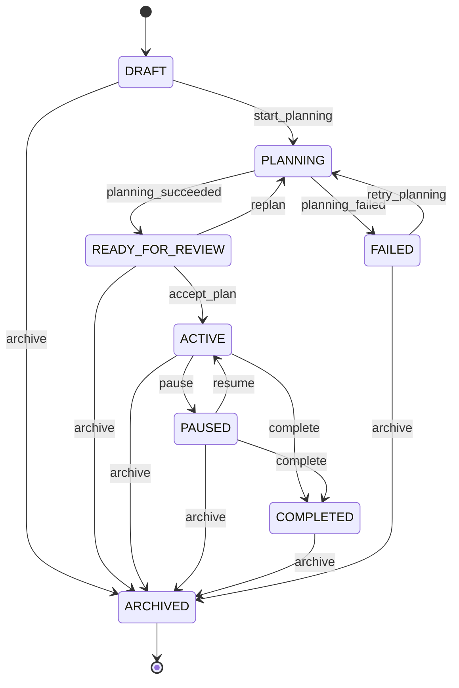
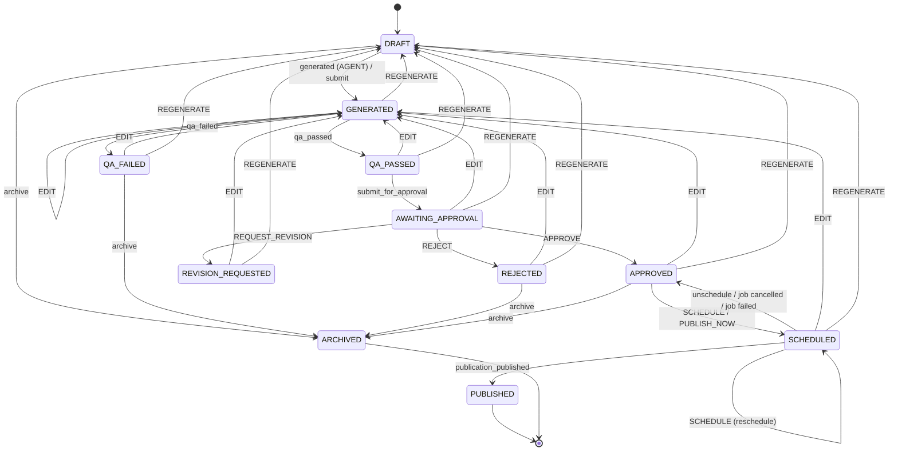
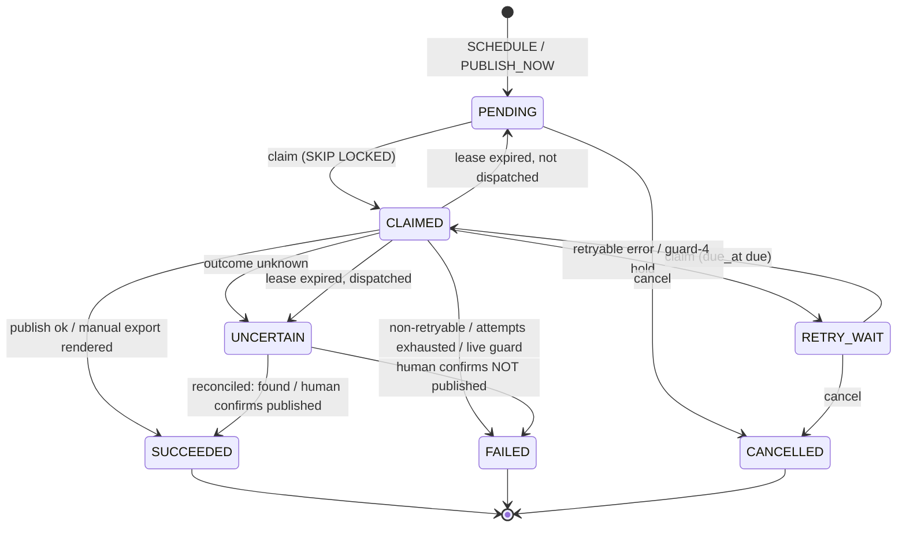
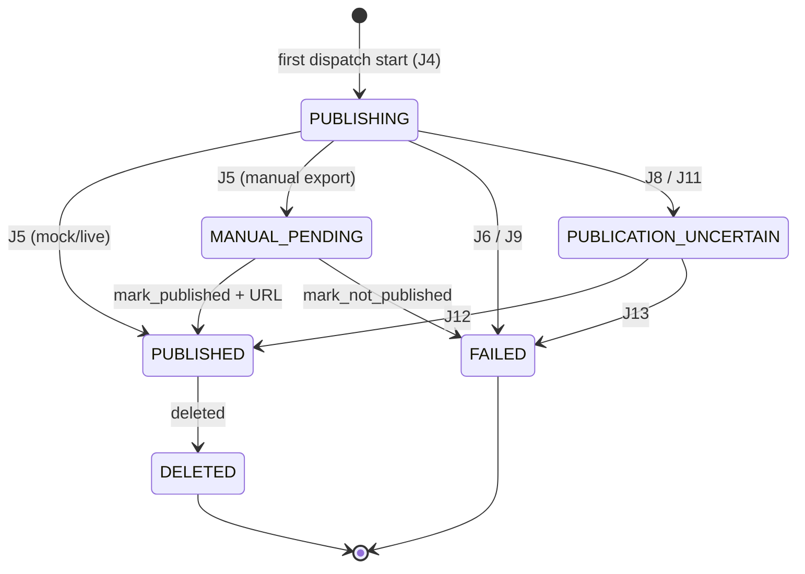
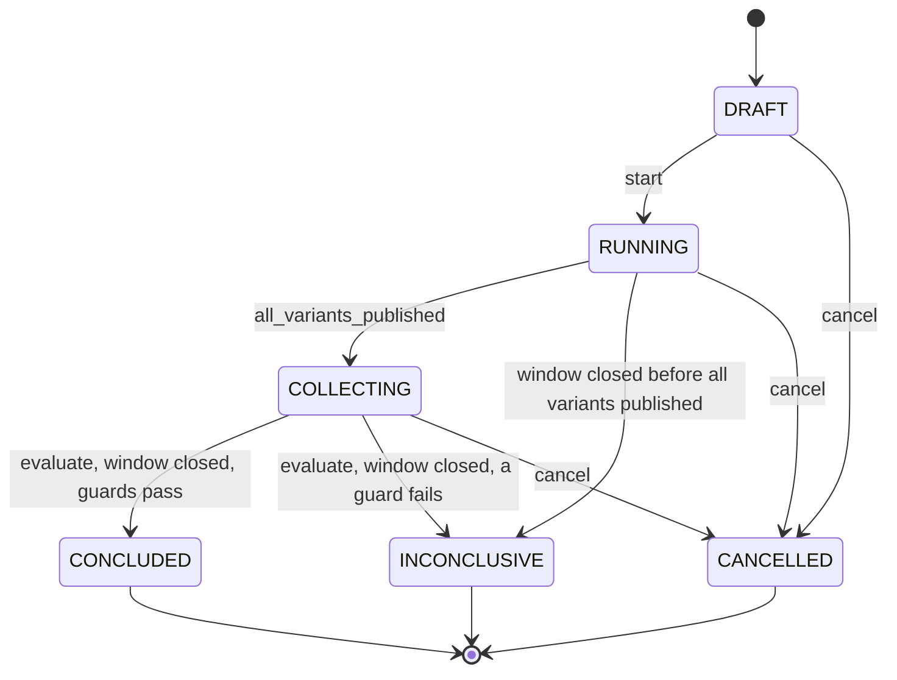

# STATE_MACHINES.md — OmniGrowth

Status: **PROPOSED** (Phase 1, documents only). Authoritative detail for GLOSSARY §4.
Precedence: `AGENTS.md` > `docs/SPEC_AMENDMENTS.md` > `docs/PHASES.md` > ADRs > `docs/spec/OMNIGROWTH_SPEC.md`.
Sources: spec §11, §12, §14, §18, §34, §36, §37, §38, §55; amendments A3, A6, A7, A9.

This document defines five status enums across four machines:

| Machine | Postgres enum | Table |
|---|---|---|
| 1. Campaign | `campaign_status` | `campaigns` |
| 2. ContentAsset | `content_asset_status` | `content_assets` |
| 3a. Publication job (outbox) | `publication_job_status` | `publication_jobs` |
| 3b. Publication (external post) | `publication_status` | `publications` |
| 4. Experiment | `experiment_status` | `experiments` |

No state names outside GLOSSARY §4 are used. Column names (e.g. `approved_version_id`, `due_at`, `claimed_at`, `lease_expires_at`) are defined in `docs/DATA_MODEL.md`, which is authoritative for them (see Q4).

Transition-ID prefixes: `C` campaign, `CA` content asset, `J` publication job, `P` publication, `E` experiment, `X` coupling. Plain `A1`–`A12` always mean SPEC_AMENDMENTS entries.

---

## 0. Conventions used in every table

### 0.1 Actor notation
`ActorType` + `UserRole` per GLOSSARY §3.

| Notation | Meaning |
|---|---|
| `H:OWNER` | HUMAN with role OWNER |
| `H:OWNER,EDITOR` | HUMAN with role OWNER or EDITOR |
| `SYSTEM` | non-scheduler automation: QA pipeline, orchestration service, reconciler job, coupling cascades, auto-approve, and **actions arriving via HMAC-verified inbound webhooks** (A7 / n8n). `actor_id` = service name (webhooks: `webhook:<source>`). |
| `SCHEDULER` | the `scheduler` process (GLOSSARY §5), which both **claims and dispatches** publication jobs — there is no separate publisher worker. Covers claim, dispatch start, publish outcome, lease recovery, and time-based transitions. `actor_id` = scheduler instance id. |
| `AGENT` | an LLM agent persisting the result of its own work. `actor_id` = agent name; `agent_run_id` in audit metadata. |

Mapping rule: every authenticated API user request is `HUMAN` (with its `UserRole`); webhook-triggered actions are `SYSTEM`; agents are `AGENT`; the scheduler (dispatcher) is `SCHEDULER`.
`VIEWER` is never allowed to trigger any transition.
`AGENT` is only ever allowed on transitions that record the agent's own output (asset generation). An agent can never approve, schedule, publish, cancel, reconcile, archive, or conclude anything.

### 0.2 Side-effect notation
- **AE** = exactly one `audit_events` row, written in the same DB transaction as the status change, with `action = 'status.transition'`, `entity_type`, `entity_id`, `brand_id`, `actor_type`, `actor_id`, `correlation_id`, and `metadata` JSON holding `{"from", "to", "trigger", "reason"}` plus context (e.g. `content_version_id`, `publication_job_id`, `error_code`); column layout per DATA_MODEL.md. Every applied transition writes AE; tables below list only *additional* side effects.
- **AA** = one `approval_actions` row (`ApprovalActionType`, actor, `content_version_id`, `comment`). Written for every §37 action in addition to AE.

### 0.3 Rejection error codes (uniform check order)
The state-machine module evaluates a transition request in this order and fails at the first failing check:

| # | Check | ErrorCode |
|---|---|---|
| 1 | Entity exists and belongs to the caller's brand scope | `NOT_FOUND` |
| 2 | `(from, to, trigger)` exists in the machine's transition table | `INVALID_STATE_TRANSITION` |
| 3 | Actor type / role is allowed for that row | `FORBIDDEN` |
| 4 | Required inputs present and well-formed (`comment`, URL, `scheduled_at`, …) | `VALIDATION_FAILURE` |
| 5 | Guard(s) true | `INVALID_STATE_TRANSITION` with `details.failed_guard=<guard name>` unless a row states otherwise (stale version binding → `CONFLICT`; A6 live guard → `LIVE_PUBLISH_BLOCKED`, HTTP 403, see §3.3) |
| 6 | Optimistic-concurrency write affects exactly 1 row | `CONFLICT` (state changed underneath the caller) |

"Error on rejection" columns below give the step-5 code; steps 1–4 and 6 apply to every row.

---

## 1. Campaign — `campaign_status`

States: `DRAFT, PLANNING, READY_FOR_REVIEW, ACTIVE, PAUSED, COMPLETED, ARCHIVED, FAILED`.

Meaning:
- `DRAFT` — created, inputs (objective, sources, platforms) editable; no orchestration running.
- `PLANNING` — Phase 5 orchestration running (strategy → research packet → ideas → plan; §55 steps 1–7).
- `READY_FOR_REVIEW` — strategy + plan persisted; waiting for human review (§38 "Review Strategy").
- `ACTIVE` — plan accepted; assets may be generated (explicit `generate_assets` trigger), approved, scheduled, published (§55 steps 8–16).
- `PAUSED` — no publication is dispatched; review/editing may continue.
- `COMPLETED` — campaign window over, nothing in flight; analytics collection continues.
- `FAILED` — orchestration failed unrecoverably during PLANNING.
- `ARCHIVED` — soft-deleted (`archived_at` set). Terminal.



`PLANNING → ARCHIVED` is intentionally absent: archive a planning campaign only after it reaches `READY_FOR_REVIEW` or `FAILED` (orchestration is not cancellable mid-flight in MVP; see Open questions).

| ID | From | To | Trigger | Guard | Actors | Side effects (besides AE) | Error on guard fail |
|---|---|---|---|---|---|---|---|
| C1 | — | DRAFT | `create` | brand exists | H:OWNER,EDITOR | insert row | `VALIDATION_FAILURE` |
| C2 | DRAFT | PLANNING | `start_planning` | `has_source`: ≥1 `source_assets` row linked and successfully ingested; objective set | H:OWNER,EDITOR | enqueue orchestration job (RQ) | `INVALID_STATE_TRANSITION` |
| C3 | PLANNING | READY_FOR_REVIEW | `planning_succeeded` | `plan_complete`: `campaign_strategies`, `research_packets`, ≥1 `content_ideas`, ≥1 `plan_items` exist for this campaign, all schema-valid | SYSTEM | — | `INVALID_STATE_TRANSITION` |
| C4 | PLANNING | FAILED | `planning_failed` | orchestration exhausted its retries; failing `agent_runs.id` + ErrorCode known | SYSTEM | store `error_code` (e.g. `LLM_OUTPUT_INVALID`, `MODEL_UNAVAILABLE`) in AE metadata | — |
| C5 | FAILED | PLANNING | `retry_planning` (API `POST /campaigns/{id}/generate` while FAILED) | `has_source` | H:OWNER,EDITOR | enqueue orchestration job | `INVALID_STATE_TRANSITION` |
| C6 | READY_FOR_REVIEW | PLANNING | `replan` (API `POST /campaigns/{id}/replan`) | none | H:OWNER,EDITOR | enqueue orchestration; previous strategy/plan kept as prior versions | — |
| C7 | READY_FOR_REVIEW | ACTIVE | `accept_plan` (API `POST /campaigns/{id}/activate`) | `plan_complete` | H:OWNER,EDITOR | set `start_date` if null. Does **not** enqueue asset generation: that is the separate explicit trigger `generate_assets` (API `POST /campaigns/{id}/generate-assets`, campaign must be `ACTIVE`), which creates `content_assets` in DRAFT via CA1 | `INVALID_STATE_TRANSITION` |
| C8 | ACTIVE | PAUSED | `pause` | none | H:OWNER,EDITOR | **coupling X1**: cancel this campaign's `PENDING`/`RETRY_WAIT` jobs; affected assets `SCHEDULED → APPROVED` | — |
| C9 | PAUSED | ACTIVE | `resume` | none | H:OWNER,EDITOR | none — cancelled jobs are **not** recreated automatically; approved assets are rescheduled by SCHEDULE (CA10) | — |
| C10 | ACTIVE | COMPLETED | `complete` (time) | `end_date` set and `< now()` AND `nothing_in_flight` | SCHEDULER | — | (no transition; re-evaluated next tick) |
| C11 | ACTIVE, PAUSED | COMPLETED | `complete` (manual) | `nothing_in_flight` | H:OWNER,EDITOR | cancel remaining `PENDING`/`RETRY_WAIT` jobs (X1) | `INVALID_STATE_TRANSITION` (`nothing_in_flight`) |
| C12 | DRAFT, READY_FOR_REVIEW, ACTIVE, PAUSED, COMPLETED, FAILED | ARCHIVED | `archive` | `nothing_in_flight` (after cancelling cancellable jobs) | H:OWNER | **coupling X2** cascade; set `archived_at` | `INVALID_STATE_TRANSITION` (`nothing_in_flight`) |

Guard `nothing_in_flight`: zero `publication_jobs` for the campaign in `CLAIMED` or `UNCERTAIN`, and zero `publications` in `PUBLICATION_UNCERTAIN` or `MANUAL_PENDING`, and zero `PUBLISHING` publications other than those of `RETRY_WAIT` jobs. (`PENDING`/`RETRY_WAIT` jobs do not block — they are cancelled as part of the transition, and their `PUBLISHING` publications go to `FAILED` per J9.)

**Terminal:** `ARCHIVED`. (`COMPLETED` and `FAILED` are resting states whose only exits are listed above.)

**Invariants**
- CI1 `archived_at IS NOT NULL ⇔ status = ARCHIVED`.
- CI2 A campaign not in `ACTIVE` has zero `publication_jobs` in `PENDING` or `RETRY_WAIT` (enforced by X1/X2 in the same transaction).
- CI3 `publication_jobs` are only claimed when the owning campaign is `ACTIVE` (claim query joins `campaigns`).
- CI4 Asset creation / `generate_assets` (CA1) requires campaign `ACTIVE`. Mutations of existing assets (`submit`, EDIT, REGENERATE, APPROVE, REJECT, REQUEST_REVISION) require campaign ∈ {`ACTIVE`, `PAUSED`}; SCHEDULE / PUBLISH_NOW require `ACTIVE`. Assets of `COMPLETED`/`ARCHIVED`/`FAILED` campaigns are frozen.

---

## 2. ContentAsset — `content_asset_status`

States: `DRAFT, GENERATED, QA_FAILED, QA_PASSED, AWAITING_APPROVAL, REVISION_REQUESTED, APPROVED, REJECTED, SCHEDULED, PUBLISHED, ARCHIVED`.

§11 default chain (every published asset traverses it; no edge skips a link):
`DRAFT → GENERATED → QA_PASSED → AWAITING_APPROVAL → APPROVED → SCHEDULED → PUBLISHED`
Side states: `QA_FAILED`, `REVISION_REQUESTED`, `REJECTED`, `ARCHIVED`.

### 2.1 Version binding (§36, §37)
- Every EDIT and every REGENERATE creates a new immutable `content_versions` row (§36: preserves original generation, human edits, prompt version, model). Versions are append-only.
- The asset holds `current_version_id` (latest version) and `approved_version_id` (nullable).
- QA results (`qa_results`) bind to a `content_version_id`. A QA result for a non-current version is discarded (logged, no transition).
- **Approval binds to a version.** APPROVE carries the `content_version_id` the approver saw; it must equal `current_version_id` (else `CONFLICT`). On success `approved_version_id := current_version_id`.
- **Edit after approval invalidates approval.** EDIT or REGENERATE from `APPROVED` or `SCHEDULED` sets `approved_version_id := NULL` in the same transaction (AA records it with `metadata.invalidated_approval_of=<old version id>`).
- The publication job pins `content_version_id = approved_version_id`; the published version is therefore exactly the approved version (§36 "final publication version").

### 2.2 Where EDIT and REGENERATE land
| Action | Nature | Lands in | Then |
|---|---|---|---|
| EDIT | synchronous — the human submits the new body; the version exists immediately | `GENERATED` | QA runs automatically (CA4–CA6 below) → `QA_PASSED` or `QA_FAILED` |
| REGENERATE | asynchronous — an LLM job must produce the version | `DRAFT` (meaning "generation pending") | writer AGENT persists the new version → `GENERATED` → QA |

Both routes re-enter the full chain, so an edited or regenerated asset is always re-QA'd and re-approved.

### 2.3 Auto-approval (§11 "Do not skip approval unless explicitly enabled")
- Per-brand boolean setting `auto_approve_enabled`, default `false`. Changing it requires H:OWNER and writes AE on the brand.
- Auto-approval does **not** skip a chain link: the asset still passes through `AWAITING_APPROVAL`; transition CA7 is then applied by `SYSTEM` (actor_id `auto_approve`) with AA `APPROVE`.
- Guard `auto_approve_allowed`: `brand.auto_approve_enabled = true` AND every `qa_results` row for `current_version_id` has outcome `PASS` (any `WARN` routes to a human).



(For readability the diagram omits `archive` from GENERATED, QA_PASSED, AWAITING_APPROVAL, REVISION_REQUESTED and SCHEDULED; the table is authoritative.)

### 2.4 Transition table

Common guard `campaign_mutable`: owning campaign ∈ {`ACTIVE`, `PAUSED`} (CI4), for mutations of existing assets. Common guard `campaign_active`: owning campaign = `ACTIVE`, for asset creation, SCHEDULE and PUBLISH_NOW.
Guard `job_cancellable`: the asset's non-terminal publication job (if any) is in `PENDING` or `RETRY_WAIT`. A job in `CLAIMED` or `UNCERTAIN` makes the asset immovable until the job resolves.

| ID | From | To | Trigger (§37 action) | Guard | Actors | Side effects (besides AE) | Error on guard fail |
|---|---|---|---|---|---|---|---|
| CA1 | — | DRAFT | `create` (via `generate_assets` from plan items, or manual create) | `campaign_active`; platform + format valid (§8) | H:OWNER,EDITOR (API); SYSTEM (webhook) | insert asset; enqueue generation job unless manual (a manual draft is completed by `submit`, CA3) | `INVALID_STATE_TRANSITION` |
| CA2 | DRAFT | GENERATED | `generated` | new `content_versions` row schema-valid and produced by the generation job currently expected for this asset (`generation_request_id` matches) | AGENT (writer), SYSTEM | set `current_version_id`; enqueue QA | stale result discarded, no transition |
| CA3 | DRAFT | GENERATED | `submit` (API `POST /content/{id}/submit`; manual first draft, synchronous; recorded as §37 EDIT in AA) | no generation job in flight for this asset; `campaign_active` | H:OWNER,EDITOR | no new version: promotes the version-1 draft created at CA1 (origin `HUMAN_EDIT`), `current_version_id` unchanged; AA; enqueue QA | `CONFLICT` (generation in flight) |
| CA4 | GENERATED | QA_PASSED | `qa_passed` | `qa_results` exist for all four `QaStage` (STRUCTURAL, BRAND, ACCURACY, PLATFORM) for `current_version_id`; none `FAIL` | SYSTEM | auto-fire CA6 | stale result discarded |
| CA5 | GENERATED | QA_FAILED | `qa_failed` | ≥1 `qa_results` row with `FAIL` for `current_version_id` | SYSTEM | findings visible in approval queue | stale result discarded |
| CA6 | QA_PASSED | AWAITING_APPROVAL | `submit_for_approval` | none (always immediate) | SYSTEM | appears in `/api/v1/approvals` queue; if `auto_approve_allowed`, auto-fire CA7 as SYSTEM | — |
| CA7 | AWAITING_APPROVAL | APPROVED | APPROVE | request `content_version_id = current_version_id`; QA passed for that version; `campaign_mutable`; if actor is SYSTEM: `auto_approve_allowed` | H:OWNER,EDITOR; SYSTEM only via auto-approve | `approved_version_id := current_version_id`; AA; if the plan item has a slot time and campaign `ACTIVE`, SYSTEM may fire CA10 | `CONFLICT` (version mismatch); `INVALID_STATE_TRANSITION` (others) |
| CA8 | AWAITING_APPROVAL | REJECTED | REJECT | `comment` non-empty | H:OWNER,EDITOR | AA (stores `comment`) | `VALIDATION_FAILURE` |
| CA9 | AWAITING_APPROVAL | REVISION_REQUESTED | REQUEST_REVISION | `comment` non-empty | H:OWNER,EDITOR | AA; `comment` stored as regeneration input | `VALIDATION_FAILURE` |
| CA10 | APPROVED | SCHEDULED | SCHEDULE | live-guard pre-check (§3.3 guards 1–3, only when `PUBLISH_MODE=LIVE`); `approved_version_id = current_version_id`; `campaign_active`; `scheduled_at` tz-aware; target `platform_accounts` row belongs to the brand and matches asset platform; no job with the same `idempotency_key` in {PENDING, CLAIMED, RETRY_WAIT, SUCCEEDED, UNCERTAIN} | H:OWNER,EDITOR; SYSTEM (plan-slot auto-schedule after approval) | AA; insert `publication_jobs` row `PENDING` (J1) with `due_at = scheduled_at`, pinned `content_version_id = approved_version_id` | `LIVE_PUBLISH_BLOCKED` (403, `details.guard`); `CONFLICT` (idempotency key taken); `INVALID_STATE_TRANSITION` (others) |
| CA11 | APPROVED | SCHEDULED | PUBLISH_NOW | as CA10 | H:OWNER,EDITOR | AA; insert job `PENDING` with `due_at = now()` — same path as SCHEDULE, no bypass | as CA10 |
| CA12 | SCHEDULED | SCHEDULED | SCHEDULE (reschedule) | live-guard pre-check as CA10; `job_cancellable`; `campaign_active` | H:OWNER,EDITOR | AA; update job `due_at` (job stays `PENDING`/`RETRY_WAIT`) | `INVALID_STATE_TRANSITION` (`job_cancellable`) |
| CA13 | SCHEDULED | APPROVED | `unschedule` | `job_cancellable` | H:OWNER,EDITOR; SYSTEM (X1/X2 cascade) | job → `CANCELLED` (J9) in same txn; approval retained | `INVALID_STATE_TRANSITION` |
| CA14 | SCHEDULED | APPROVED | `publication_failed` | job just reached `FAILED` (J6/J11/J13) | SYSTEM | approval retained; failure shown; manual retry = SCHEDULE again (CA10, new job row) | — |
| CA15 | SCHEDULED | PUBLISHED | `publication_published` | the asset's publication reached `PUBLISHED` for `approved_version_id` (P2/P5/P7) | SYSTEM | set `published_at` from publication | — |
| CA16 | GENERATED, QA_PASSED, QA_FAILED, AWAITING_APPROVAL, REVISION_REQUESTED, APPROVED, REJECTED | GENERATED | EDIT | `campaign_mutable` | H:OWNER,EDITOR | new version; `current_version_id`; `approved_version_id := NULL`; AA; enqueue QA | `INVALID_STATE_TRANSITION` |
| CA17 | SCHEDULED | GENERATED | EDIT | `campaign_mutable`; `job_cancellable` | H:OWNER,EDITOR | cancel job (J9) first, then as CA16 | `INVALID_STATE_TRANSITION` (`job_cancellable`) |
| CA18 | GENERATED, QA_PASSED, QA_FAILED, AWAITING_APPROVAL, REVISION_REQUESTED, APPROVED, REJECTED | DRAFT | REGENERATE | `campaign_mutable`; if actor is SYSTEM: from = `REVISION_REQUESTED` or (`QA_FAILED` and `auto_regeneration_count < limit`) | H:OWNER,EDITOR; SYSTEM (see guard) | `approved_version_id := NULL`; AA; enqueue generation job with new `generation_request_id` (inputs: revision `comment` / QA findings) | `INVALID_STATE_TRANSITION` |
| CA19 | SCHEDULED | DRAFT | REGENERATE | `campaign_mutable`; `job_cancellable` | H:OWNER,EDITOR | cancel job (J9) first, then as CA18 | `INVALID_STATE_TRANSITION` |
| CA20 | DRAFT, GENERATED, QA_PASSED, QA_FAILED, AWAITING_APPROVAL, REVISION_REQUESTED, APPROVED, REJECTED | ARCHIVED | `archive` | none | H:OWNER,EDITOR; SYSTEM (X2 cascade) | set `archived_at`; `approved_version_id := NULL` (keeps AI1); drop from queues | — |
| CA21 | SCHEDULED | ARCHIVED | `archive` | `job_cancellable` | H:OWNER,EDITOR; SYSTEM (X2) | cancel job (J9) first; `approved_version_id := NULL` (keeps AI1); set `archived_at` | `INVALID_STATE_TRANSITION` |

§37 action coverage: APPROVE → CA7 · REJECT → CA8 · REQUEST_REVISION → CA9 · EDIT → CA3 (`submit`), CA16, CA17 · REGENERATE → CA18, CA19 · SCHEDULE → CA10, CA12 · PUBLISH_NOW → CA11. Every one writes AA and records the actor (§37 "Record who made each change").

Not allowed (examples → `INVALID_STATE_TRANSITION`): `QA_PASSED → APPROVED` (skips AWAITING_APPROVAL), `AWAITING_APPROVAL → SCHEDULED`, `QA_FAILED → AWAITING_APPROVAL`, any exit from `PUBLISHED` or `ARCHIVED`, REGENERATE from `DRAFT`, APPROVE/SCHEDULE by AGENT.

QA infrastructure failure (e.g. `MODEL_TIMEOUT` inside Accuracy QA) is **not** `QA_FAILED`: the asset stays `GENERATED`, the QA job is retried, and the error is recorded on the `agent_runs`/`model_runs` row. `QA_FAILED` means the content failed a check. Likewise a failed generation job leaves the asset in `DRAFT` with the error on its `agent_runs` row; a human may re-trigger generation.

**Terminal:** `PUBLISHED`, `ARCHIVED`. (`REJECTED` is resting; exits only via EDIT, REGENERATE, archive.)

**Invariants**
- AI1 `approved_version_id IS NOT NULL ⇔ status ∈ {APPROVED, SCHEDULED, PUBLISHED}`, and in those states `approved_version_id = current_version_id`.
- AI2 `status = SCHEDULED ⇔` exactly one `publication_jobs` row for (`approved_version_id`, target account) in {PENDING, CLAIMED, RETRY_WAIT, UNCERTAIN}, **or** a `SUCCEEDED` job whose publication is `MANUAL_PENDING`.
- AI3 `status = PUBLISHED ⇒` a `publications` row with status `PUBLISHED` (or later `DELETED`) whose job's `content_version_id = approved_version_id`.
- AI4 Every asset in {QA_PASSED, AWAITING_APPROVAL, APPROVED, SCHEDULED, PUBLISHED} has four non-FAIL `qa_results` rows for `current_version_id`.
- AI5 No transition into `APPROVED` has `actor_type ∈ {AGENT, SCHEDULER}`; `SYSTEM` only when `auto_approve_allowed` held at that moment (recorded in AE metadata).
- AI6 `content_versions` rows are never updated or deleted.
- AI7 A `PUBLISHED` asset is never set to `ARCHIVED`; archiving its campaign sets `archived_at` only (history preserved).

---

## 3. Publication — `publication_job_status` and `publication_status`

Two machines, deliberately separate (A3):
- **`publication_jobs`** (outbox, source of truth for *intent to publish*): one row per (content version, platform account) attempt series. Owned by the `scheduler` process, which both claims and dispatches (the "dispatcher"); there is no separate publisher worker.
- **`publications`** (the external post): created the first time a dispatch actually starts; records `external_post_id`, `canonical_url`, `published_at`, `publish_mode`, `error`. Relationship: `publications.publication_job_id` unique → **1 job : 0..1 publication**.

### 3.1 Idempotency (A3)
- `idempotency_key = sha256_hex(lower(content_version_id) + ':' + lower(platform_account_id))`: both canonical hyphenated UUID strings, lower-cased, joined by a single colon, UTF-8 encoded, hex digest.
- Unique index on `idempotency_key` — scoped as a **partial unique index** over `status IN (PENDING, CLAIMED, RETRY_WAIT, SUCCEEDED, UNCERTAIN)`. `FAILED` and `CANCELLED` jobs are excluded because both are *proven not published* (see J6/J9/J11/J13), which is what makes "manual retry" (§14) possible as a fresh row. (This narrows A3's wording and is **PROPOSED**, pending human approval at the Phase 1 gate via ADR-0003; see Q1.)
- The key is passed to the platform adapter; where a platform supports idempotency tokens it is forwarded (capability UNVERIFIED per `docs/PLATFORM_CAPABILITIES.md`). The mock publisher honours it: the same key returns the same synthetic `external_post_id`.

### 3.2 Publisher selection by `PublishMode` (evaluated at dispatch time, not schedule time)
| `PUBLISH_MODE` | Publisher | Outcome on success |
|---|---|---|
| `MOCK` (default) | `MockPublisher` (§34): validates content, synthetic `external_post_id` (`mock_<uuid>`), `canonical_url` `mock://<platform>/<id>`; zero network I/O; deterministic fault injection for tests (rate limit, connect timeout, post-send timeout) | publication `PUBLISHED` |
| `MANUAL` | `ManualExportPublisher` (A6) for every platform: renders copy + media checklist | publication `MANUAL_PENDING` |
| `LIVE` | real adapter **only if the live guard passes** and the platform's publish capability is `VERIFIED`; platforms without a usable publish API use `ManualExportPublisher` | `PUBLISHED` or `MANUAL_PENDING` |

The mode actually used is stored on the publication row (`publish_mode`) and in AE metadata.

### 3.3 Live guard (A6): the single authoritative specification
Other documents reference this section; they do not restate it.

Conditions (all must hold for a live request to be sent):
1. `settings.PUBLISH_MODE == LIVE`.
2. `platform_accounts.live_enabled = true` for the job's account.
3. The job's `content_version_id` equals the asset's `approved_version_id` and the asset is `SCHEDULED` (i.e. an APPROVED content version).
4. No `publications` row in `PUBLICATION_UNCERTAIN` for the same `platform_account_id`.

Plus **hard block**: if `settings.ENV == test`, live dispatch is impossible regardless of the above: (a) settings validation refuses `PUBLISH_MODE=live` when `ENV=test` at startup, and (b) the dispatcher independently re-checks `ENV` and refuses (`LIVE_PUBLISH_BLOCKED`, `details.guard=ENV_TEST`). A test proves both (A6). Operationally, AGENTS.md §3 additionally forbids any agent from setting `PUBLISH_MODE=live` without the human phrase `ENABLE LIVE PUBLISHING FOR <platform>`.

**When each guard is checked**

| Guard | At SCHEDULE / PUBLISH_NOW request (CA10/CA11/CA12): early reject | At dispatch start (J4): authoritative re-check |
|---|---|---|
| 1 `PUBLISH_MODE` | Read to decide whether the request is a live one; mode ≠ LIVE → live guard does not apply (mock/manual publisher; not an error) | Re-read; mode ≠ LIVE → mock/manual publisher |
| 2 `live_enabled` | Checked when mode = LIVE; false → reject | Re-checked; false → job `FAILED` (J6) |
| 3 approved version | Checked when mode = LIVE; false → reject | Re-checked; false → job `FAILED` (J6) (should be unreachable: EDIT/REGENERATE cancel the job) |
| 4 open `PUBLICATION_UNCERTAIN` on the account | **Not checked** at request time | Checked; true (an uncertain post exists) → job **held in `RETRY_WAIT`** (J7), `details.guard=OPEN_UNCERTAIN`, no attempt counted, `due_at := now() + uncertain_hold`. Enforced in **MOCK as well as LIVE**, so tests exercise it |

Error reporting: every live-guard refusal uses ErrorCode **`LIVE_PUBLISH_BLOCKED`** (GLOSSARY §4a), HTTP **403**, with `details.guard ∈ {ENV_TEST, ACCOUNT_NOT_LIVE_ENABLED (guard 2), VERSION_NOT_APPROVED (guard 3), OPEN_UNCERTAIN (guard 4)}` — the same value set as API_PLAN §6.5 (guard 1 false is not a refusal: the job simply uses the mock/manual publisher). At request time it is the API error response; at dispatch it is written to the job's `last_error_code` and AE metadata. The guard-4 hold records `LIVE_PUBLISH_BLOCKED` as `last_error_code` but is a hold, not a failure.

### 3.4 Claim, lease, dispatch protocol
1. **Claim (SCHEDULER, one short txn):** sets `claimed_at` together with `claim_token` and `lease_expires_at` (DATA_MODEL CHECK: `status <> 'CLAIMED' OR (claimed_at IS NOT NULL AND lease_expires_at IS NOT NULL)`).
   ```sql
   UPDATE publication_jobs j
      SET status='CLAIMED', claim_token=:uuid, claimed_by=:scheduler_id,
          claimed_at = now(), lease_expires_at = now() + :lease
    WHERE j.id IN (
      SELECT pj.id FROM publication_jobs pj
        JOIN content_assets a ON a.id = pj.content_asset_id
        JOIN campaigns c      ON c.id = a.campaign_id
       WHERE pj.status IN ('PENDING','RETRY_WAIT') AND pj.due_at <= now()
         AND a.status = 'SCHEDULED' AND c.status = 'ACTIVE'
       ORDER BY pj.due_at
       LIMIT :batch
       FOR UPDATE OF pj SKIP LOCKED)
   RETURNING j.*;
   ```
   Overdue rows are simply due rows → missed-job recovery after downtime is automatic (A3).
2. **Dispatch start (scheduler as dispatcher, one txn, committed *before* any network I/O):** `UPDATE … SET dispatch_started_at=now(), attempt_count=attempt_count+1 WHERE id=:id AND status='CLAIMED' AND claim_token=:t AND lease_expires_at > now() + :request_timeout`; evaluate the live guard; create the `publications` row in `PUBLISHING` if none exists (J4/P1). If rowcount = 0 the dispatcher aborts without calling the platform.
3. **Call the publisher** (outside any DB transaction).
4. **Record outcome (one txn, optimistic):** `… WHERE id=:id AND status='CLAIMED' AND claim_token=:t`. If rowcount = 0 (lease was recovered meanwhile) and the call *succeeded*, the dispatcher applies J12 (UNCERTAIN → SUCCEEDED) with the `external_post_id` it holds; otherwise it logs and exits.

Lease rules: lease duration > request timeout + margin; the dispatcher may extend the lease (heartbeat) only while it still holds `claim_token`.

### 3.5 Error classification at step 4
| Observed | Proven not published? | ErrorCode | Job goes to |
|---|---|---|---|
| Platform returned 429 / rate-limit response | yes (explicit rejection) | `PLATFORM_RATE_LIMIT` | `RETRY_WAIT` (J7) or `FAILED` when attempts exhausted (J6) |
| Timeout during DNS / TCP connect / TLS handshake, before the request body was sent | yes | `PLATFORM_TIMEOUT` | `RETRY_WAIT` / `FAILED` |
| Timeout or connection loss **after** the request was sent | **no** | `PUBLICATION_UNCERTAIN` | `UNCERTAIN` (J8) |
| 5xx or unparseable response after send | **no** | `PUBLICATION_UNCERTAIN` | `UNCERTAIN` |
| 401/403 | yes | `PLATFORM_AUTH_FAILURE` | `FAILED` (not retried) |
| 4xx content validation rejection | yes | `VALIDATION_FAILURE` | `FAILED` |
| Scheduler crash / lease expiry after `dispatch_started_at` set (publisher with external side effect, incl. MOCK) | **no** | `PUBLICATION_UNCERTAIN` | `UNCERTAIN` (J11) |
| Lease expiry with `dispatch_started_at` NULL, or `ManualExportPublisher` (no external side effect) | yes | — | `PENDING` (J10) |

Only `PLATFORM_RATE_LIMIT` and pre-send `PLATFORM_TIMEOUT` are retryable. Backoff: exponential with full jitter, `base * 2^(attempt-1)` capped at `max_delay`, honouring `Retry-After` when present; `max_attempts` from config. Never assume a failed request means not published (§14).

### 3.6 `publication_job_status` machine

States: `PENDING, CLAIMED, SUCCEEDED, RETRY_WAIT, FAILED, UNCERTAIN, CANCELLED`.



| ID | From | To | Trigger | Guard | Actors | Side effects (besides AE) | Error on guard fail |
|---|---|---|---|---|---|---|---|
| J1 | — | PENDING | SCHEDULE / PUBLISH_NOW (CA10/CA11) | see CA10 | (inherits CA10/CA11 actor) | compute `idempotency_key`; insert | `CONFLICT` (key) |
| J2 | PENDING | CLAIMED | `claim` | `due_at <= now()`; asset `SCHEDULED`; campaign `ACTIVE`; row not locked | SCHEDULER | set `claim_token`, `claimed_by`, `claimed_at`, `lease_expires_at` | row skipped |
| J3 | RETRY_WAIT | CLAIMED | `claim` | as J2 | SCHEDULER | as J2 | row skipped |
| J4 | CLAIMED | CLAIMED | `dispatch_start` | holds `claim_token`; lease remaining > request timeout; live guard evaluated (3.3) | SCHEDULER (dispatcher) | `dispatch_started_at`, `attempt_count+1`; publication P1 if first dispatch | abort, no call; guard 2/3 fail → J6 (`LIVE_PUBLISH_BLOCKED`); guard 4 → J7 hold |
| J5 | CLAIMED | SUCCEEDED | `publish_succeeded` | holds `claim_token` | SCHEDULER (dispatcher) | publication → `PUBLISHED` (P2) or `MANUAL_PENDING` (P4); if P2 then asset CA15 | `CONFLICT` → see 3.4 step 4 |
| J6 | CLAIMED | FAILED | `publish_failed` | error proven-not-published and (non-retryable or `attempt_count >= max_attempts`), or live guard 2/3 failed (`LIVE_PUBLISH_BLOCKED`) | SCHEDULER (dispatcher) | publication → `FAILED` (P3) if it exists; asset CA14; `last_error_code` | `CONFLICT` |
| J7 | CLAIMED | RETRY_WAIT | `publish_retryable` / `blocked_by_uncertain` | retryable error (3.5) and `attempt_count < max_attempts`; or live-guard condition 4 holds the job (attempt not counted) | SCHEDULER (dispatcher) | `due_at := now() + backoff`; `last_error_code`; publication stays `PUBLISHING` | `CONFLICT` |
| J8 | CLAIMED | UNCERTAIN | `publish_uncertain` | outcome unknown (3.5) | SCHEDULER (dispatcher) | publication → `PUBLICATION_UNCERTAIN` (P6); enqueue reconciliation; asset stays `SCHEDULED`; account blocked for further dispatch (guard 4) | `CONFLICT` |
| J9 | PENDING, RETRY_WAIT | CANCELLED | `cancel` | none (status itself is the guard) | H:OWNER,EDITOR; SYSTEM (CA13/CA17/CA19/CA21, X1, X2) | if a `PUBLISHING` publication exists (from an earlier attempt) → `FAILED` (P3, `error.reason=cancelled`); asset CA13 unless the caller is already moving the asset | `INVALID_STATE_TRANSITION` from CLAIMED/UNCERTAIN |
| J10 | CLAIMED | PENDING | `lease_expired_not_dispatched` | `lease_expires_at < now()` and (`dispatch_started_at IS NULL` or publisher has no external side effect) | SCHEDULER | clear `claim_token`, `claimed_by`, `claimed_at`, `lease_expires_at`, `dispatch_started_at` | — |
| J11 | CLAIMED | UNCERTAIN | `lease_expired_dispatched` | `lease_expires_at < now()` and `dispatch_started_at IS NOT NULL` and publisher has external side effect | SCHEDULER | as J8 | — |
| J12 | UNCERTAIN | SUCCEEDED | `reconciled_found` / `human_confirmed_published` | SYSTEM: adapter lookup (by `external_post_id` if known, else account-recent-posts match on content hash — capability per platform, UNVERIFIED) returned positive evidence; HUMAN: `canonical_url` supplied | SYSTEM (reconciler); H:OWNER,EDITOR | publication P5 → `PUBLISHED` with evidence; asset CA15; unblocks account | `VALIDATION_FAILURE` (URL) |
| J13 | UNCERTAIN | FAILED | `human_confirmed_not_published` | explicit human confirmation with `comment`; **never automatic** (absence in a lookup is not proof) | H:OWNER | publication P7b → `FAILED`; asset CA14; unblocks account; re-publish only via a new SCHEDULE (new row, never an auto-retry) | `FORBIDDEN` for non-OWNER |

**Terminal:** `SUCCEEDED`, `FAILED`, `CANCELLED`. `UNCERTAIN` is non-terminal but has **no automatic exit to any retry path**.

**Invariants**
- JI1 `UNCERTAIN` is never followed by a dispatch of the same job; there is no `UNCERTAIN → PENDING/RETRY_WAIT/CLAIMED` edge.
- JI2 `attempt_count` increments only at J4 (dispatch start); claims and guard-4 holds do not count.
- JI3 At most one row per `idempotency_key` in {PENDING, CLAIMED, RETRY_WAIT, SUCCEEDED, UNCERTAIN} (partial unique index) → two schedulers racing produce exactly one publication (Phase 7 gate test).
- JI4 A job in `FAILED` or `CANCELLED` is proven never to have reached the platform, or a human attested it did not (J13).
- JI5 `CLAIMED` rows always have non-null `claim_token`, `claimed_at` and `lease_expires_at` (DATA_MODEL CHECK); every transition out of `CLAIMED` clears them.
- JI6 Non-terminal jobs pin `content_version_id = content_assets.approved_version_id`.

### 3.7 `publication_status` machine

States: `PUBLISHING, PUBLISHED, PUBLICATION_UNCERTAIN, FAILED, MANUAL_PENDING, DELETED`.



| ID | From | To | Trigger | Guard | Actors | Side effects (besides AE) | Error on guard fail |
|---|---|---|---|---|---|---|---|
| P1 | — | PUBLISHING | J4 first dispatch | job `CLAIMED` with claim token | SCHEDULER (dispatcher) | insert row, `publish_mode` recorded | — |
| P2 | PUBLISHING | PUBLISHED | J5 | `external_post_id` present | SCHEDULER (dispatcher) | `published_at`, `canonical_url`; asset CA15 | — |
| P3 | PUBLISHING | FAILED | J6 / J9 | job moving to FAILED/CANCELLED in same txn | SCHEDULER (J6); J9's actor (J9) | `error` (code + message) | — |
| P4 | PUBLISHING | MANUAL_PENDING | J5 via `ManualExportPublisher` | export package rendered and stored | SCHEDULER (dispatcher) | export available at API; asset stays `SCHEDULED` | — |
| P5 | PUBLICATION_UNCERTAIN | PUBLISHED | J12 | as J12 | SYSTEM; H:OWNER,EDITOR | reconciliation evidence in AE metadata; asset CA15 | `VALIDATION_FAILURE` |
| P6 | PUBLISHING | PUBLICATION_UNCERTAIN | J8 / J11 | as J8/J11 | SCHEDULER | blocks live/mock dispatch for this account (guard 4) | — |
| P7 | MANUAL_PENDING | PUBLISHED | `mark_published` (API action) | `canonical_url` is an absolute `https` URL whose host is in the platform's configured domain allowlist; optional `external_post_id` | H:OWNER,EDITOR | `published_at` (supplied or now); asset CA15 | `VALIDATION_FAILURE` |
| P7b | PUBLICATION_UNCERTAIN | FAILED | J13 | as J13 | H:OWNER | — | `FORBIDDEN` |
| P8 | MANUAL_PENDING | FAILED | `mark_not_published` (API action) | `comment` non-empty | H:OWNER,EDITOR | asset CA14 (→ `APPROVED`). The job stays `SUCCEEDED`, so the same version cannot be rescheduled to the same account; EDIT creates a new version/key (Q3) | `VALIDATION_FAILURE` |
| P9 | PUBLISHED | DELETED | `deleted` (API action for HUMAN; detection for SYSTEM) | HUMAN: in LIVE, a delete via adapter passes live guards 1–2 (§3.3; refusal → `LIVE_PUBLISH_BLOCKED`) or the human attests external deletion; SYSTEM: metrics fetch returns a definitive not-found | H:OWNER; SYSTEM | asset stays `PUBLISHED` (history); analytics stop polling | `INVALID_STATE_TRANSITION` |

**Terminal:** `FAILED`, `DELETED`. (`PUBLISHED` exits only to `DELETED`.)

### 3.8 Relation between the two machines
| `publication_job_status` | Allowed `publication_status` (row may be absent where marked "none") |
|---|---|
| `PENDING` | none (never dispatched), or `PUBLISHING` (left by an earlier attempt that ended in RETRY_WAIT, or by a no-side-effect dispatch recovered via J10) |
| `CLAIMED` | none, or `PUBLISHING` |
| `RETRY_WAIT` | none, or `PUBLISHING` |
| `SUCCEEDED` | `PUBLISHED`, `MANUAL_PENDING`, `DELETED`, or `FAILED` (only via P8) |
| `UNCERTAIN` | `PUBLICATION_UNCERTAIN` |
| `FAILED` | none or `FAILED` |
| `CANCELLED` | none or `FAILED` |

Both rows are always written in the same transaction when both change. The asset follows the publication (CA14/CA15), never the job alone.

---

## 4. Experiment — `experiment_status`

States: `DRAFT, RUNNING, COLLECTING, CONCLUDED, INCONCLUSIVE, CANCELLED`.

Meaning: `RUNNING` = variants are being approved/scheduled/published (exposure phase). `COLLECTING` = every variant is published; metrics accumulate until the observation window `end` closes. `CONCLUDED` = a winner was declared with adequate evidence. `INCONCLUSIVE` = the window closed but evidence was inadequate (§18: "Do not declare a winning variant with inadequate data").

Tracked per §18: `hypothesis`, variants (`experiment_variants`, ≥2), `metric`, `start`, `end`, `sample_size`, `result`, `confidence`. Thresholds: `min_sample_size` (per variant, in the metric's denominator unit, e.g. impressions for CTR) and `confidence_threshold`, defaulted from config and frozen on the experiment at start.

> **Superseded by SPEC_AMENDMENTS A14 (2026-09-26).**
> - `min_sample_size` counts **independent posts per variant** (never impressions or repeated pulls). It is the frozen max(power requirement at 80%, floor 30).
> - `confidence_threshold` / `confidence` are the **interval level** (1 − α).
> - The E4 guard "computed confidence ≥ threshold" means: randomized design, REAL (non-simulated) data, every variant n ≥ `min_sample_size`, and a Bonferroni-adjusted two-sided Welch p-value < α in the favourable direction. With several such treatments, the best one must also beat the others pairwise.
> - E2 additionally requires a human attestation that variants differ only in the declared variable (`design.single_variable_attested`), and an `end_at` that leaves at least `observation_hours`.
> - Units are recorded in `experiment_units`. E3 fires when every variant has at least one PUBLISHED unit.
> - Observational experiments always end INCONCLUSIVE (`observational_design`).
> - Method: docs/EXPERIMENTS.md.



| ID | From | To | Trigger | Guard | Actors | Side effects (besides AE) | Error on guard fail |
|---|---|---|---|---|---|---|---|
| E1 | — | DRAFT | `create` | campaign ∈ {ACTIVE, PAUSED} | H:OWNER,EDITOR | insert | `INVALID_STATE_TRANSITION` |
| E2 | DRAFT | RUNNING | `start` | hypothesis, metric, `end` set; ≥2 `experiment_variants`, each linked to ≥1 content asset not in {REJECTED, ARCHIVED}; variants differ only in the declared variable; `min_sample_size` and `confidence_threshold` set; campaign `ACTIVE` | H:OWNER,EDITOR | `start := now()`; thresholds frozen | `INVALID_STATE_TRANSITION` |
| E3 | RUNNING | COLLECTING | `all_variants_published` | every variant has ≥1 asset `PUBLISHED` | SYSTEM (on CA15) | — | — |
| E4 | COLLECTING | CONCLUDED | `evaluate` | `now() >= end` AND every variant `sample_size >= min_sample_size` AND metric non-null for every variant (no fake zeros) AND computed `confidence >= confidence_threshold` | SYSTEM (evaluator job); SCHEDULER (window-close tick); H:OWNER,EDITOR (request evaluation) | persist `result`, `confidence`, `sample_size` per variant, `winner_variant_id`, and the `analytics_snapshots` IDs used as evidence | no transition if `now() < end` (evaluation before the window closes never concludes — no peeking); otherwise E5 applies |
| E5 | COLLECTING | INCONCLUSIVE | `evaluate` | `now() >= end` AND NOT (E4 guards) | SYSTEM; SCHEDULER; H:OWNER,EDITOR | persist `result` with the failing guard(s) (`insufficient_sample`, `below_confidence`, `metric_unavailable`); `winner_variant_id` stays NULL | — |
| E6 | RUNNING | INCONCLUSIVE | `window_closed` | `now() >= end` and some variant has no `PUBLISHED` asset | SCHEDULER | reason `variants_not_published` | — |
| E7 | DRAFT, RUNNING, COLLECTING | CANCELLED | `cancel` | none | H:OWNER,EDITOR; SYSTEM (X2 campaign archive) | reason recorded | — |

**Terminal:** `CONCLUDED`, `INCONCLUSIVE`, `CANCELLED`. Extending an experiment = create a new one (Q7).

**Invariants**
- EI1 `winner_variant_id IS NOT NULL ⇔ status = CONCLUDED`.
- EI2 `CONCLUDED ⇒` every variant's recorded `sample_size >= min_sample_size` and `confidence >= confidence_threshold`, using the thresholds frozen at E2 (Phase 9 gate test).
- EI3 `CONCLUDED` rows reference ≥1 evidence `analytics_snapshots` id per variant; recommendations (§19) may cite only `CONCLUDED` experiments as winner evidence.
- EI4 Thresholds cannot be changed after `DRAFT`.

---

## 5. Cross-machine coupling rules

All coupled changes happen **in one DB transaction** with row locks taken in a fixed order to avoid deadlocks: `campaigns` → `experiments` → `content_assets` → `publication_jobs` → `publications`. External calls are never inside these transactions.

| ID | When | Then (same txn) |
|---|---|---|
| X1 | Campaign → `PAUSED` (C8), or manual `COMPLETED` (C11) | Every job of the campaign in `PENDING`/`RETRY_WAIT` → `CANCELLED` (J9, actor SYSTEM, reason `campaign_paused`); their `PUBLISHING` publications → `FAILED`; their assets `SCHEDULED → APPROVED` (CA13). `CLAIMED` jobs finish normally; `UNCERTAIN` jobs keep their assets `SCHEDULED`. Resume (C9) recreates nothing. |
| X2 | Campaign → `ARCHIVED` (C12) | X1; then every asset not in {PUBLISHED, ARCHIVED} → `ARCHIVED` (CA20/CA21); `PUBLISHED` assets get `archived_at` only (AI7); experiments in {DRAFT, RUNNING, COLLECTING} → `CANCELLED` (E7). Blocked by `nothing_in_flight`. |
| X3 | Campaign not `ACTIVE` | No claim (CI3), no SCHEDULE/PUBLISH_NOW (CA10/CA11). |
| X4 | Job `SUCCEEDED` with publication `PUBLISHED` (J5/J12), or publication `MANUAL_PENDING → PUBLISHED` (P7) | Asset `SCHEDULED → PUBLISHED` (CA15). **An asset becomes PUBLISHED only via its publication reaching PUBLISHED.** |
| X5 | Job `FAILED` (J6/J13) or publication `MANUAL_PENDING → FAILED` (P8) | Asset `SCHEDULED → APPROVED` (CA14); approval kept. |
| X6 | Job `UNCERTAIN` (J8/J11) | Publication `PUBLICATION_UNCERTAIN`; asset stays `SCHEDULED`; all further dispatches on that `platform_account_id` held in `RETRY_WAIT` (guard 4) until reconciled; reconciliation job enqueued; campaign cannot complete/archive (`nothing_in_flight`). |
| X7 | Asset EDIT / REGENERATE / unschedule / archive while `SCHEDULED` (CA13, CA17, CA19, CA21) | Job cancelled first (J9); refused if job is `CLAIMED` or `UNCERTAIN`. EDIT/REGENERATE clear `approved_version_id`. |
| X8 | Asset → `PUBLISHED` (CA15) | If every variant of a `RUNNING` experiment containing the asset is now published → experiment `COLLECTING` (E3). |
| X9 | Publication → `DELETED` (P9) | Asset stays `PUBLISHED`; analytics polling stops; any `COLLECTING` experiment using it evaluates with metrics up to the deletion time (flagged in `result`). |
| X10 | Brand `auto_approve_enabled` changed | Affects only future CA7 evaluations; already-approved assets are unaffected. |

---

## 6. Enforcement

- **Single writer.** `omnigrowth/core/state_machines/` (GLOSSARY §5) is the only code allowed to write any of the five `status` columns. Transition tables in this document are encoded there as data (`from`, `to`, `trigger`, `guards`, `actors`, `effects`); guards are pure functions over a context loaded in the same transaction.
- **API.** One entry point per machine, conceptually `transition(session, entity_id, trigger, actor, *, expected_from=None, inputs) -> TransitionResult`, which runs the §0.3 check order, applies coupled transitions (§5), writes AE (+ AA where applicable), and raises a categorised `OmniGrowthError` with the ErrorCode from §0.3 on rejection. Rejections are logged with `correlation_id` (no AE row — Q9).
- **Optimistic concurrency.** Every write is compare-and-set:
  `UPDATE <table> SET status=:to, updated_at=now() WHERE id=:id AND status=:from` (plus `AND claim_token=:t` for job outcomes). `rowcount != 1` → `CONFLICT`. Where guards read other rows (e.g. `job_cancellable`), those rows are locked `FOR UPDATE` in the fixed order of §5.
- **No direct assignment (AGENTS.md §4).** A test walks `omnigrowth/` (AST) and fails on any assignment to a `.status` attribute, any `status=` keyword in `insert()/update().values()`, or raw SQL `SET status` outside `omnigrowth/core/state_machines/`. Additionally, ORM `status` attributes reject writes outside the module's context (defence in depth).
- **Table tests.** (a) Exhaustive matrix: every `(from, to)` pair not in a table raises `INVALID_STATE_TRANSITION`; (b) every row's actor restrictions (`FORBIDDEN`); (c) Python state enums equal the Postgres enums equal GLOSSARY §4; (d) Mermaid edges in this doc match the encoded table (doc-drift test, optional).
- **Required behaviour tests (from PHASES.md / A6):** two schedulers racing → exactly one publication; live-guard refusals return `LIVE_PUBLISH_BLOCKED` with the correct `details.guard` both at request time and at dispatch; `PUBLICATION_UNCERTAIN` path incl. lease-expiry-after-dispatch; live dispatch impossible when `ENV=test`; no winner below thresholds; EDIT after approval clears `approved_version_id`; approval with stale `content_version_id` → `CONFLICT`.
- **Audit.** `audit_events` is append-only (no UPDATE/DELETE grants for the app role).

---

## 7. Open questions

Q1. **Adopted in all docs, pending human approval at the Phase 1 gate (ADR-0003 PROPOSED).** Partial vs full unique index on `idempotency_key`. A3 says "unique index". This doc scopes it to `status IN (PENDING, CLAIMED, RETRY_WAIT, SUCCEEDED, UNCERTAIN)` so that manual retry after a proven-not-published `FAILED`/`CANCELLED` can insert a new row. Alternative: full unique index and manual retry revives the same row (`FAILED → PENDING`), which would make `FAILED` non-terminal. Needs primary-agent / ADR-0003 decision; affects DATA_MODEL.

Q2. **Proposed name: `publication_status` `CANCELLED`.** Cancelling a `RETRY_WAIT` job whose publication is already `PUBLISHING` currently maps the publication to `FAILED` with `error.reason=cancelled`. A distinct `CANCELLED` publication state would be more honest. Not used here.

Q3. **Proposed name: `publication_job_status` `AWAITING_MANUAL`.** In the manual path the job goes `SUCCEEDED` when the export is rendered, so a human "mark not published" (P8) leaves the idempotency key consumed and the same version cannot be rescheduled to that account without an EDIT. A job state held until the human confirms would fix this. Not used here.

Q4. **RESOLVED (primary): all columns below now exist in DATA_MODEL.md (`run_at` renamed `due_at`). Audit `from_status`/`to_status`/`trigger`/`reason` are stored in `audit_events.metadata` JSON (`{"from","to","trigger","reason"}`) with `action = 'status.transition'`.** Column names used by this doc (defined in DATA_MODEL.md): `content_assets.current_version_id`, `content_assets.approved_version_id`, `content_assets.published_at`, `content_assets.generation_request_id`, `content_assets.auto_regeneration_count`; `brands.auto_approve_enabled` (or on `brand_profiles`?); `publication_jobs.{idempotency_key, content_asset_id, content_version_id, platform_account_id, due_at, claim_token, claimed_by, claimed_at, lease_expires_at, dispatch_started_at, attempt_count, max_attempts, last_error_code}`; `publications.{publication_job_id, publish_mode, external_post_id, canonical_url, error}`; `experiments.{min_sample_size, confidence_threshold, winner_variant_id}`; `audit_events.{action, entity_type, entity_id, actor_type, actor_id, correlation_id, metadata}`.

Q5. **Assumed config keys:** `publishing.lease_seconds`, `publishing.request_timeout_seconds`, `publishing.max_attempts`, `publishing.backoff_base_seconds`, `publishing.backoff_max_seconds`, `publishing.uncertain_hold_seconds`, `publishing.domain_allowlist.<platform>`, `qa.max_auto_regenerations` (default 0 = off), `experiments.min_sample_size`, `experiments.confidence_threshold`.

Q6. **DECIDED (2026-09-23, Phase 1 gate): LIVE requires a HUMAN approval.** When `PUBLISH_MODE=LIVE`, live guard 3 additionally requires that the approval of `approved_version_id` was recorded with `actor_type=HUMAN`; SYSTEM auto-approval only satisfies MOCK/MANUAL publishing. Original question: A6 requires "an APPROVED content version". This doc does not decide whether a SYSTEM auto-approval satisfies live guard 3, or whether LIVE must additionally require a HUMAN approval (i.e. `auto_approve_enabled` ignored in LIVE); DATA_MODEL.md leaves it open too. Needs human decision at the Phase 1 gate (AGENTS.md §7: state-machine ambiguity).

Q7. **Campaign plan approval vs. §55's single "user approves" step.** This doc requires a human `accept_plan` (C7), then an explicit `generate_assets` trigger, then a human APPROVE per asset. The §55 E2E test would perform all three. Confirm, or allow SYSTEM to activate the campaign after planning.

Q8. **Resume behaviour (C9).** Paused-then-resumed campaigns do not auto-recreate cancelled jobs. Alternative: on resume, SYSTEM reschedules assets whose original `scheduled_at` is still in the future. Also: should `COMPLETED → ACTIVE` (reopen) exist, and should `PLANNING` be cancellable/archivable?

Q9. **Audit rejected attempts?** Currently only applied transitions write `audit_events`; rejections go to structured logs. Security review may want rejected HUMAN attempts (esp. `FORBIDDEN`) in `audit_events` too.

Q10. **One asset → one platform account.** AI2 assumes each asset targets exactly one `platform_account_id`. Multi-account publishing of the same asset would need per-account status (or one asset per account).

Q11. **Reconciliation capability.** Automated J12 needs per-platform lookup (by ID or recent-posts search); all are UNVERIFIED until PLATFORM_CAPABILITIES.md says otherwise. Until then, UNCERTAIN in LIVE resolves only by human confirmation.

Q12. **Sample-size unit and statistical test** for E4 (per-metric denominator; test choice, e.g. two-proportion z-test for rate metrics) belong in the Phase 9 design; this doc only fixes the guard.

Q13. **5xx classified as UNCERTAIN.** Conservative per §14; some platforms may document that a given 5xx is pre-commit. Per-platform overrides only when VERIFIED.

## 7. Supporting machines (added Phase 4)

Not part of the four core machines; recorded here so every status writer is documented.
All transitions write audit events (AE).

### 7.1 SourceAsset (`source_asset_status`)
Pasted text is created `PENDING` and normalised in the same transaction (SA1 -> SA2).
Uploads and URLs are created `PENDING` at request time and moved to a terminal state by the
`SOURCE_INGEST` job (SA2/SA3/SA4). A `FAILED` source can be retried (SA5) — the
`(brand_id, checksum)` unique constraint means identical content can never be re-inserted
as a new row, so retry is the only recovery path for transient failures.

| ID | From | To | Trigger | Actors |
|---|---|---|---|---|
| SA1 | — | PENDING | `create` | H:OWNER,EDITOR; SYSTEM |
| SA2 | PENDING | NORMALIZED | `normalized` | SYSTEM |
| SA3 | PENDING | FAILED | `failed` (error_code set; also on queue-down and reaped jobs) | SYSTEM |
| SA4 | PENDING | UNSUPPORTED | `unsupported` (AUDIO/VIDEO until transcription exists) | SYSTEM |
| SA5 | FAILED | PENDING | `retry` (`POST /sources/{id}/retry`, new job) | H:OWNER,EDITOR |

### 7.2 Job (`job_status`, DATA_MODEL section 6a.1)

| ID | From | To | Trigger | Actors |
|---|---|---|---|---|
| JB1 | — | QUEUED | `enqueue` | H:OWNER,EDITOR; SYSTEM; SCHEDULER; AGENT |
| JB2 | QUEUED | RUNNING | `start` | SYSTEM (worker) |
| JB3 | RUNNING | SUCCEEDED | `succeed` | SYSTEM |
| JB4 | RUNNING | FAILED | `fail` (domain error, or known infrastructure error wrapped) | SYSTEM |
| JB5 | QUEUED | CANCELLED | `cancel` (also when the queue is unreachable at dispatch) | H:OWNER,EDITOR; SYSTEM |
| JB6 | RUNNING | FAILED | `reap` (RUNNING longer than 15 min: worker died / RQ timeout) | SCHEDULER |

### 7.3 AgentRun (`agent_run_status`, added Phase 5)
One row per specialised agent call (`agents/base.py::run_agent`). The row is inserted and
committed `RUNNING` before the model is called, so an attempt is visible even if the worker
dies; its `model_runs` rows link to it. Terminal states are final: a rerun is a new row.

| ID | From | To | Trigger | Actors |
|---|---|---|---|---|
| AR1 | — | RUNNING | `start` (pins `prompt_version_id`, records `input_ref`) | SYSTEM; AGENT; H:OWNER,EDITOR |
| AR2 | RUNNING | SUCCEEDED | `succeed` (stores validated `output`, `finished_at`) | SYSTEM |
| AR3 | RUNNING | FAILED | `fail` (stores `error_code`, `finished_at`) | SYSTEM |

### 7.4 ContentIdea (`content_idea_status`, added Phase 5)
Ideas are created by the Opportunity Agent (CI1). The planning pipeline's deterministic mix
selection moves the chosen ideas to `SELECTED` (CI2, SYSTEM). A newer planning run moves
the previous mix back to `PROPOSED` (CI4, SYSTEM); only humans restore a discarded idea. An agent can create ideas but never select them.

| ID | From | To | Trigger | Actors |
|---|---|---|---|---|
| CI1 | — | PROPOSED | `create` | AGENT; SYSTEM |
| CI2 | PROPOSED | SELECTED | `select` | SYSTEM; H:OWNER,EDITOR |
| CI3 | PROPOSED | DISCARDED | `discard` | SYSTEM; H:OWNER,EDITOR |
| CI4 | SELECTED | PROPOSED | `deselect` (SYSTEM: a newer planning run supersedes the mix) | SYSTEM; H:OWNER,EDITOR |
| CI5 | DISCARDED | PROPOSED | `restore` | H:OWNER,EDITOR |

### 7.5 Recommendation (`recommendation_status`, added after the MVP milestone)
Created by the Optimization Agent only when every cited label resolves to a stored
`analytics_snapshots` row (evidence rule, Phase 9 gate enforced since Phase 7). A human then
accepts or dismisses it; the decision is final and records `decided_by_actor_*`.

| ID | From | To | Trigger | Actors |
|---|---|---|---|---|
| RC1 | — | PROPOSED | `create` | AGENT (optimizer); SYSTEM |
| RC2 | PROPOSED | ACCEPTED | `accept` (`POST /recommendations/{id}/accept`) | H:OWNER,EDITOR |
| RC3 | PROPOSED | DISMISSED | `dismiss` (`POST /recommendations/{id}/dismiss`) | H:OWNER,EDITOR |

### 7.6 Notes on content-asset transitions implemented after the MVP
- CA12 reschedule = J9 cancel of the pending job + new J1 row + SCHEDULED -> SCHEDULED, one
  transaction; refused while the job is CLAIMED or UNCERTAIN.
- CA17 / CA19 (EDIT / REGENERATE of a SCHEDULED asset) cancel the pending job first (X7).
- EDIT and REGENERATE record `invalidated_approval_of` in the transition's audit metadata when
  they clear an approval.
- CA7 by SYSTEM (brand `auto_approve_enabled`) runs right after CA6 and writes an
  `approval_actions` row with actor `SYSTEM:auto-approve`.

